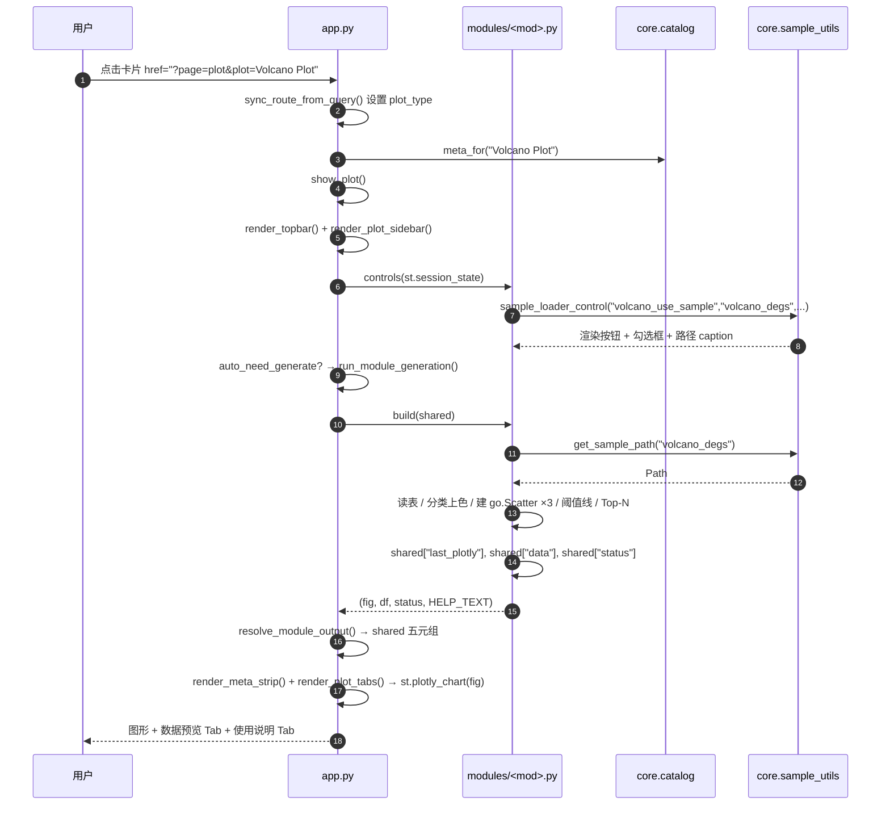
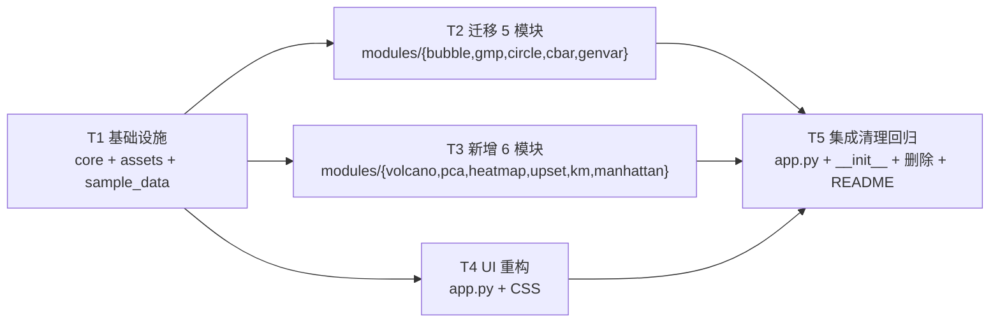

# 架构设计与任务分解 · 原生图库融合（Native Fusion v3.0）

> 注：本文档记录 v3.0 融合时的 23 个模块。此后新增 `Paired Tree Comparison`（ggtree 双树比较，见 `docs/ggtree-paired-tree.md`），当前实际为 **24 个模块 / 6 分类 / 34 份示例数据**；模块契约（`controls` / `build`）未变。

| 项 | 内容 |
|---|---|
| 文档版本 | v1.0 |
| 对应 PRD | `docs/prd-native-fusion.md`（v1.0 增量） |
| 基线 | v2.1 · 12 原生 Plotly 模块 + 5 个 iframe 外挂应用 |
| 目标 | v3.0 · 23 个站内原生模块 · 6 分类 · 单进程 |
| 撰写人 | 高见远（架构师） |
| 技术栈 | Streamlit + Plotly（不引入新前端框架、不新增第三方依赖） |
| 产出定位 | 只做架构与任务分解，不含实现代码，不改 `app.py` |

---

## 0. 结论摘要（先读这一段）

1. **本次是「替换 + 补全」，不是「新增」**：5 个 iframe 应用整体迁入 A 体系（`app/modules/*.py` 的 `controls()` / `build()` 契约），B 体系（`external.py` / `static/apps/` / `shiny_apps/` / 启动脚本）整体删除。
2. **零新依赖**：`scipy.cluster.hierarchy`（Heatmap 聚类）、`numpy.linalg.svd`（PCA）、numpy 手算 log-rank（KM）已全部满足；`lifelines` 只在存在时可选增强，不写入 `requirements.txt`。
3. **契约不变**：23 个模块统一 `controls(shared)` + `build(shared) -> (fig, data, status, help_text)`；`app.py` 的 `render_plot_sidebar()` / `run_module_generation()` / `render_export_popover()` / `resolve_module_output()` 全部保留，只做增量改造。
4. **两处硬约束必须先落地，否则后面全崩**：
   - `reset_module_colors()` 必须补齐 11 个前缀，且**所有颜色类 session key 必须含 `color` 子串**（该函数按子串过滤）。
   - 隐藏 Streamlit 原生 header 后，顶栏在主内容流内 `position: sticky`，**不覆盖 sidebar**；sidebar 不再需要 56px padding 补偿。
5. **任务共 5 个**：T1 基础设施 → T2 五个重写模块 → T3 六个新增模块 → T4 UI 重构 → T5 清理与回归。T2/T3/T4 只依赖 T1，**三者可并行**。

---

# Part A · 系统设计

## 1. 总体方案与分层

### 1.1 技术难点与选型

| # | 难点 | 说明 | 选型 / 对策 |
|---|---|---|---|
| D1 | **环形复合极坐标图** | CircleViz 需要「3 层同心环 + 第 4 层径向柱 + 环形网络连线 + 中心节点」在同一个坐标系内 | Plotly `polar` 子图 + **全部用 `go.Scatterpolar` 手算多边形**。**不使用 `go.Barpolar`**——`Barpolar` 没有 `base`/`r0` 属性，无法画「从 r=a 到 r=b」的环段，只能从圆心起算。环形柱统一用 4 顶点闭合多边形实现（详见 §3.3） |
| D2 | **多轨道基因组图** | GenVar 需要在同一 X 轴（基因组坐标）叠 3 条不同 Y 语义的轨道 | 单 Cartesian 坐标系 + 约定 Y 值域（基因结构 y=0，上轨 y>0.15，下轨 y<-0.15），**不用 subplot**。棒棒糖垂直线用「单 trace + `None` 断点」技巧，避免每点一个 trace |
| D3 | **Streamlit 内实现常规网页顶栏** | 原生 `stHeader` 不能承载导航；`st.markdown` 输出的是 HTML 片段，无法内嵌 Streamlit 控件 | 隐藏 `stHeader`，用 `st.columns` 组成顶栏（左 3 列纯 markdown/链接，右 1 列真控件 `st.radio` 做主题），整条容器用 CSS `position: sticky` 吸顶 |
| D4 | **热图层次聚类但不画树** | PRD 只要求「可选行/列聚类」，未要求 dendrogram | `scipy.cluster.hierarchy.linkage` + `leaves_list` 只做**行/列重排序**，`go.Heatmap` 出图。画树留 P2 |
| D5 | **Kaplan-Meier 的 log-rank p 值** | 不想引入 `lifelines` | numpy 手算 Mantel-Haenszel log-rank：两组闭式公式，多组用「观测-期望」矩阵 + 卡方。用 `scipy.stats.chi2.sf` 取 p（`scipy` 已在依赖里） |
| D6 | **UpSet 三面板组合** | 上交集柱 / 左集合总量 / 下点阵矩阵，三者尺寸联动 | `make_subplots(rows=2, cols=2, row_heights=[0.62,0.38], column_widths=[0.28,0.72], shared_xaxes='col', shared_yaxes='row')`；点阵用 `go.Scatter` markers + `None` 断点连线 |
| D7 | **23 模块首页性能** | 23 张内联 SVG + 4 列卡片 | `preview_svg()` 已有 `@lru_cache`；每张 SVG ≤4KB；首页只渲染筛选后的卡片；**不预生成任何图** |
| D8 | **BubbleViz 逐帧动画** | `px.scatter(animation_frame=...)` 无法控制每帧 marker 尺寸与固定坐标范围（帧间会跳轴） | 手写 `go.Figure` + `frames` + `updatemenus`(播放/暂停) + `sliders`(时间轴)，全局固定 `xaxis.range`/`yaxis.range` |
| D9 | **删除 iframe 体系而不破坏 12 个现有模块** | `app.py` 顶层 `from app.core.external import ...` 与 `components.iframe` 强耦合 | **一次性同批提交**：删 `external.py` 的同时删除 `app.py` 里 6 个 external 相关函数与 2 处 import。`MODULES` 字典与 `resolve_module_output()` 完全不动 |

### 1.2 分层

```
┌──────────────────────────────────────────────────────────────────────┐
│ 页面层  app.py                                                        │
│   init_state / sync_route_from_query / inject_css                    │
│   render_topbar（新增）                                               │
│   show_home → render_page_head / render_category_pills / render_gallery│
│   show_plot → render_plot_sidebar / render_plot_header /              │
│               render_toolbar / render_plot_tabs（新增）/ render_meta_strip│
│               render_plot_panel / render_export_popover(scale)        │
└───────────────────────────┬──────────────────────────────────────────┘
                            │ 只通过 4 个契约交互
                            │ ① MODULES[name].controls(st.session_state)
                            │ ② MODULES[name].build(shared) -> (fig,data,status,help)
                            │ ③ meta_for(name) / preview_svg(name) / search_plots(...)
                            │ ④ sample_loader_control(...)
┌───────────────────────────┴──────────────────────────────────────────┐
│ 核心层  app/core/                                                     │
│   catalog.py     PLOTS(23) / CATEGORY_ORDER(6) / preview_svg / search │
│   theme.py       THEMES[Light|Dark] + 11 组新色 key                    │
│   sample_utils.py SAMPLE_PATHS(30) / sample_loader_control / zip      │
│   io_utils.py    read_table / read_matrix_like（复用，不改）           │
│   plot_utils.py  fig_to_bytes（仅 matplotlib 分支用，不改）            │
│   external.py    ★删除                                                │
└───────────────────────────┬──────────────────────────────────────────┘
┌───────────────────────────┴──────────────────────────────────────────┐
│ 模块层  app/modules/  23 个模块，每个文件结构完全同构：                 │
│   HELP_TEXT: str                                                      │
│   controls(shared: dict) -> None        # 只画控件，不画图             │
│   build(shared: dict) -> tuple          # 只画图，写 shared            │
│   （保留 render(shared) / __call__ 别名，供旧调用路径兼容）            │
└───────────────────────────┬──────────────────────────────────────────┘
┌───────────────────────────┴──────────────────────────────────────────┐
│ 数据层                                                                │
│   sample_data/*.csv|txt    30 份（16 旧 + 14 新）                      │
│   app/assets/previews/*.svg 23 张（17 旧，其中 5 张复用给迁移模块；6 新）│
└──────────────────────────────────────────────────────────────────────┘
```

### 1.3 如何移除 iframe 体系且不破坏现有 12 模块

**删除清单（同一次提交内完成，顺序不可拆）**

| 步骤 | 动作 | 为什么必须同批 |
|---|---|---|
| 1 | 删除 `app/core/external.py` | — |
| 2 | 删除 `app.py` 第 22–28 行 `from app.core.external import (...)` | 否则 import 即崩 |
| 3 | 删除 `app.py` 第 13 行 `import streamlit.components.v1 as components` | 唯一使用者是 `show_app()` |
| 4 | 删除函数：`open_app`、`render_app_sidebar`、`render_app_header`、`render_shiny_launcher`、`show_app`、`external_card_html`、`render_external_gallery` | 均引用 `EXTERNAL_APPS` |
| 5 | `sync_route_from_query()` 删掉 `app = _qp_value(...)` 与 `elif page == "app"` 分支，只保留 `plot` 判定 | 否则 `EXTERNAL_APPS` NameError |
| 6 | `init_state()` 删掉 `"app_name": None`；`open_plot()` / `go_home()` 删掉 `app_name` 赋值与 `del st.query_params["app"]` | 同一原因 |
| 7 | `render_footer()` 中 `{len(EXTERNAL_APPS)} 应用` 改为纯 `{len(MODULES)} 图形 · {len(SAMPLE_PATHS)} 份示例数据` | 同一原因 |
| 8 | `render_hero()` 中的 `plot_count + len(EXTERNAL_APPS)` 改为 `len(MODULES)`（该函数在 T4 会被 `render_page_head()` 整体替换） | 同一原因 |
| 9 | 删除目录/文件：`static/apps/`、`shiny_apps/`、`run_shiny_apps.py`、`run_shiny_apps.bat`、`run_shiny_apps.sh`、`start_all.bat` | — |
| 10 | `README.md` 同步：模块数 12→23、分类 3→6、删除 R Shiny / run_shiny_apps / start_all 段落、新增 11 个模块数据格式表 | AC-27 / AC-28 / AC-29 |

**不动的部分（这是「不破坏 12 模块」的核心保障）**

- `MODULES` 字典结构不变，只是从 12 项扩到 23 项 —— 5 个迁移模块**直接沿用英文原名作为 key**（`BubbleViz` 等），路由 `?plot=BubbleViz` 天然可用，`open_plot()` 无需任何改动。
- `render_plot_sidebar(module_obj, meta)` → `module_obj.controls(st.session_state)` 契约不变。
- `run_module_generation()` / `resolve_module_output()` 完全不动 —— 它们只依赖 `build()` 存在与返回元组，与模块内部实现无关。
- `render_export_popover(meta)` 只加一个 scale 单选，`meta.sample_keys` 驱动的示例 zip 下载逻辑不变。
- `io_utils.py` / `plot_utils.py` 一行不改。

**迁移顺序建议**：先加 11 个模块（`MODULES` 23 项）→ 首页/绘图页能跑通 → 最后才删 `external.py` 与启动脚本。这样任一时刻站点都可运行，出问题只需 revert 删除那一步。这两步都在 **T5 内部**按此顺序执行（见 §7 T5 与 §9「T5 删除动作必须最后做」）。

---

## 2. 最终 23 个模块完整注册表

> `MODULES` key = `catalog.PLOTS` key = `?plot=` 参数值 = `meta.name`，四者严格一致。
> 「颜色前缀」= 该模块所有 `st.color_picker` / 颜色类 session key 的**统一前缀**，必须登记进 `reset_module_colors()`。

### 2.1 原有 12 个（模块代码不改，仅登记颜色前缀）

| # | 文件名 | MODULES key | catalog 分类 | sample_keys | 预览 SVG | 颜色前缀 |
|---|---|---|---|---|---|---|
| 1 | `arc.py` | `Arc Diagram` | 网络关系 | `arc` | `arc.svg` | `arc_` |
| 2 | `heb.py` | `Hierarchical Edge Bundling` | 网络关系 | `heb` | `heb.svg` | `heb_` |
| 3 | `chord_edgelist.py` | `Chord Diagram` | 网络关系 | `chord` | `chord.svg` | `ch_` / `chord_` |
| 4 | `nodelink.py` | `Node-link Diagram` | 网络关系 | `nodelink` | `nodelink.svg` | `ndl_` |
| 5 | `sankey_d3.py` | `Sankey` | 网络关系 | `sankey_links`、`sankey_nodes` | `sankey.svg` | `sk_` / `sankey_` |
| 6 | `raincloud.py` | `Raincloud Plot` | 分布比较 | `raincloud` | `raincloud.svg` | `rc_` / `rain_` |
| 7 | `beeswarm.py` | `Beeswarm` | 分布比较 | `beeswarm` | `beeswarm.svg` | `bee_` |
| 8 | `splitviolin.py` | `Split Violin` | 分布比较 | `splitviolin` | `splitviolin.svg` | `sv_` / `splitviolin_` |
| 9 | `scaboxden.py` | `ScaBoxDen` | 分布比较 | `scaboxden` | `scaboxden.svg` | `sbd_` |
| 10 | `pirate.py` | `Pirate Plot` | 分布比较 | `pirate_cont`、`pirate_cat` | `pirate.svg` | `pir_` / `pirate_` |
| 11 | `mantel.py` | `Mantel Test` | 统计与富集 | `mantel_spec`、`mantel_env` | `mantel.svg` | `mt_` / `mantel_` |
| 12 | `goenrich.py` | `GO Enrichment` | 统计与富集 | `go_bar`、`go_bubble` | `go.svg` | `go_` |

### 2.2 迁移 5 个（重写为原生模块；保留英文原名，中文别名进 tags）

| # | 文件名 | MODULES key | catalog 分类 | sample_keys | 预览 SVG | 颜色前缀 | tags（含中文别名） |
|---|---|---|---|---|---|---|---|
| 13 | `bubble.py` | `BubbleViz` | 分布比较 | `bubble_country`、`bubble_aqi` | `bubbleviz.svg`（复用） | `bubble_` | `bubble, scatter, animation, 气泡图, 气泡, 动态气泡` |
| 14 | `grouped_matrix.py` | `Grouped Matrix Plotting` | 矩阵与热图 | `gmp_matrix` | `gmp.svg`（复用） | `gmp_` | `matrix, heatmap, group, 分组矩阵, 分类矩阵, 点阵` |
| 15 | `circle_viz.py` | `CircleViz` | 环形与极坐标 | `circleviz_cis_ctrl` | `circleviz.svg`（复用） | `circle_` | `circular, network, ring, 环形网络, 环图, 同心环` |
| 16 | `circular_bar.py` | `CircularBarPlot` | 环形与极坐标 | `circularbar_genes` | `circularbar.svg`（复用） | `cbar_` | `circular, bar, rose, 玫瑰图, 环形柱, 极坐标柱` |
| 17 | `genomic_variation.py` | `Genomic Variation Viewer` | 基因组与生存 | `genvar_feature`、`genvar_snp_upper`、`genvar_snp_lower` | `genvar.svg`（复用） | `genvar_` | `genome, track, snp, 基因组轨道, 变异, 棒棒糖图` |

### 2.3 新增 6 个

| # | 文件名 | MODULES key | catalog 分类 | sample_keys | 预览 SVG | 颜色前缀 | tags |
|---|---|---|---|---|---|---|---|
| 18 | `volcano.py` | `Volcano Plot` | 统计与富集 | `volcano_degs` | `volcano.svg`（新） | `volcano_` | `differential, volcano, 火山图, 差异表达, deg` |
| 19 | `pca.py` | `PCA` | 统计与富集 | `pca_samples` | `pca.svg`（新） | `pca_` | `ordination, pca, 降维, 主成分, qc` |
| 20 | `heatmap.py` | `Heatmap` | 矩阵与热图 | `heatmap_expression` | `heatmap.svg`（新） | `heatmap_` | `matrix, heatmap, cluster, 热图, 聚类, 表达矩阵` |
| 21 | `upset.py` | `UpSet Plot` | 矩阵与热图 | `upset_genesets` | `upset.svg`（新） | `upset_` | `set, intersection, upset, 交集, 集合, venn` |
| 22 | `kaplan_meier.py` | `Kaplan-Meier` | 基因组与生存 | `km_survival` | `km.svg`（新） | `km_` | `survival, kaplan, 生存曲线, 生存分析, km` |
| 23 | `manhattan.py` | `Manhattan Plot` | 基因组与生存 | `manhattan_gwas` | `manhattan.svg`（新） | `manhattan_` | `gwas, manhattan, 曼哈顿图, 全基因组, 关联` |

### 2.4 `CATEGORY_ORDER` 最终值（顺序即首页 pill Tab 顺序）

```python
CATEGORY_ORDER = (
    "网络关系",      # 5
    "分布比较",      # 6
    "矩阵与热图",    # 3
    "环形与极坐标",  # 2
    "统计与富集",    # 4
    "基因组与生存",  # 3
)
```

5+6+3+2+4+3 = **23**，与 `PLOTS` 长度一致。`grouped_plots()` 无需改动，它已按 `CATEGORY_ORDER` 建桶并过滤空桶。

### 2.5 一键核对清单（工程师可直接当断言用）

| 断言 | 期望值 |
|---|---|
| `len(PLOTS)` | 23 |
| `len(MODULES)` | 23 |
| `set(PLOTS) == set(MODULES)` | `True` |
| `len(CATEGORY_ORDER)` | 6 |
| `len(SAMPLE_PATHS)` | 30 |
| `len({k for m in PLOTS.values() for k in m.sample_keys})` | 30（无孤儿 key） |
| `reset_module_colors()` 内 `prefixes` 长度 | 29（18 旧 + 11 新） |
| `app/assets/previews/*.svg` 数量 | 23 |
| `app/modules/*.py` 数量（不含 `__init__.py`） | 23 |
| `grep -r "EXTERNAL_APPS\|components.iframe\|run_shiny_apps\|shiny_apps\|static/apps"` | 0 命中 |

---

## 3. 11 个新模块设计

### 3.0 统一约定（所有新模块必须遵守）

**文件骨架**（与 `arc.py` 同构，便于评审）

```
HELP_TEXT: str                      # 多行字符串，render_help() 直接 st.markdown
def controls(shared: dict) -> None  # 只放控件；首行 sample_loader_control(...)
def build(shared: dict):            # 只画图；末尾 return fig, data, status, HELP_TEXT
def render(shared: dict):           # controls + build 兼容别名
__call__ = render
```

**`build()` 的四条硬性要求**

1. 写 `shared["last_plotly"] = fig` —— 不要只 `return fig`，`render_plot_panel()` 优先读 `shared`。
2. 写 `shared["data"]` —— DataFrame，或 `dict[str, DataFrame]`（后者会被 `render_data_preview()` 自动渲染成多个 Tab）。
3. 写 `shared["status"]` —— 一句中文，含行数 / 维度 / 关键统计。
4. **任何失败路径都 `return None, None, "中文错误提示", HELP_TEXT`，绝不 `raise`** —— 否则 `run_module_generation()` 会把它变成 error 且丢掉 `help_text`。

**颜色取值规范**

```python
theme = THEMES[st.session_state.theme]
color = st.session_state.get("volcano_up_color", theme["volcano_up"])
```

「默认值来自 theme，用户改过就用 session_state」。这样主题切换 + `reset_module_colors()` 删 key 后自动回落到新主题默认值。

**Plotly 布局规范**

```python
fig.update_layout(
    plot_bgcolor=theme["bg"], paper_bgcolor=theme["bg"],
    font=dict(color=theme["text"], size=12),
    margin=dict(l=60, r=30, t=50, b=50),
    height=560,                      # 不写 width，交给 use_container_width
    hovermode="closest",
)
```

`width` 一律不写，否则窄屏出现横向滚动（违反 AC-19 / AC-20）。

**非颜色控件禁词**：见 §10.1 —— 任何**不是颜色**的控件 key 都禁止包含 `color` / `fill` / `edge` / `line` / `bg` / `reg` 子串，否则会在主题切换时被 `reset_module_colors()` 误删。

---

### 3.1 `bubble.py` · BubbleViz

**输入 schema**

| 模式 | 必需列 | 说明 |
|---|---|---|
| 动画模式 | `x`、`y`、`size`、`color`、`frame` | `frame` 为整数或可排序字符串（如 `Year`） |
| 静态模式 | `x`、`y` | `size` / `color` / `label` 可选 |

列名不区分大小写，按别名表匹配：`x∈{x,X,time,date}`、`y∈{y,Y,value}`、`size∈{size,Size,population,Population}`、`color∈{color,Color,Continent,group}`、`frame∈{frame,year,Year,Date}`。匹配不到时用 `st.selectbox` 让用户手动指定，**不要直接报错**。

**build 输出**：`(fig, df, status, HELP_TEXT)`；`status` 形如 `BubbleViz 就绪：231 行 × 6 列；动画帧 12 个（1970–2021）`。

**Plotly trace 选型**

- 单点集合用一个 `go.Scatter(mode="markers")`：颜色映射列传 `marker.color=<数值列>` + `marker.colorscale` + `marker.showscale=True`。
- 动画：`fig.frames = [go.Frame(name=str(v), data=[go.Scatter(...v 对应的子集...)]) for v in frame_values]`。
- 播放控件：`fig.layout.updatemenus`（播放/暂停）+ `fig.layout.sliders`（时间轴）。
- **关键**：先算全局 `x`/`y` 取值范围，写死 `xaxis.range` / `yaxis.range`。否则每帧自动缩放，视觉上「跳」得厉害。
- 大小映射用 `marker.size` 直接传**归一化后的像素直径**：`size_px = 6 + 34 * (v - vmin) / (vmax - vmin)`，比 `sizeref` 更可控。

**控件清单**

| widget | key | 默认值 | 说明 |
|---|---|---|---|
| `sample_loader_control` | `bubble_use_sample` / `bubble_load_sample_btn` | `True` | sample_keys=`["bubble_country","bubble_aqi"]` |
| `selectbox` 示例数据选择 | `bubble_sample_pick` | `bubble_country` | 两选一 |
| `file_uploader` | `bubble_file_upload` | — | 关闭示例时显示 |
| `selectbox` x 列 | `bubble_col_x` | 自动匹配 | |
| `selectbox` y 列 | `bubble_col_y` | 自动匹配 | |
| `selectbox` size 列 | `bubble_col_size` | 自动匹配 | 含「(固定大小)」 |
| `selectbox` color 列 | `bubble_col_color` | 自动匹配 | 含「(单色)」 |
| `selectbox` frame 列 | `bubble_col_frame` | 自动匹配 | 含「(静态)」 |
| `selectbox` 配色方案 | `bubble_palette` | `Viridis` | `Viridis`/`Plasma`/`Bluyl`/`Sunset` |
| `slider` 最大气泡直径(px) | `bubble_size_scale` | 40（10–120） | |
| `slider` 透明度 | `bubble_opacity` | 0.75（0.1–1.0） | |
| `number_input` 帧间隔(ms) | `bubble_frame_ms` | 600 | 200–3000 |
| `checkbox` 显示标签 | `bubble_show_label` | `False` | 取 color 列值 |
| `slider` 标签字号 | `bubble_label_size` | 10（8–18） | |
| `checkbox` + `text_input` 标题 | `bubble_add_title` / `bubble_title` | `False` / `"Bubble Chart"` | |

**风险**：`frame` 唯一值个数即帧数。若用户上传 500 帧，`fig.frames` 会显著拖慢渲染 → `if len(frame_values) > 60: 取前 60 并在 status 中提示「帧数过多，已截取前 60 帧」`。

---

### 3.2 `grouped_matrix.py` · Grouped Matrix Plotting

**输入 schema**：长表 `row` / `group` / `column` / `category`（`category` 可为空字符串）。宽表也支持（第 1 列行名，其余为 `column`），此时 `group` 由 `selectbox` 指定或统一填 `"All"`。

**build 输出**：`(fig, long_df, status, HELP_TEXT)`；`status` 形如 `GMP 就绪：26 行 × 8 列；6 个分组；3 个类别`。

**Plotly trace 选型**

- **每类别一个 `go.Scatter(mode="markers")`**（不是每格一个 trace）：一次性传该类别的所有 `(x, y)`。26×8=208 格只有 ≤4 个 trace。
- 分组色块与分组名：`fig.add_shape(type="rect")` 画左侧色条，`go.Scatter(mode="text")` 在色条旁写分组名。
- 网格：`update_xaxes(showgrid=True, gridcolor=theme["grid_color"], gridwidth=0.6)`；外框用 `add_shape(type="rect", xref="paper", yref="paper", x0=0, y0=0, x1=1, y1=1)`；双线外框 = 两个内缩的 rect。
- Y 轴反向：`yaxis.autorange="reversed"`，保证第一行在顶部。

**控件清单**

| widget | key | 默认值 |
|---|---|---|
| `sample_loader_control` | `gmp_use_sample` / `gmp_load_sample_btn` | `True`，sample_keys=`["gmp_matrix"]` |
| `file_uploader` | `gmp_file_upload` | — |
| `radio` 数据形态 | `gmp_layout_mode` | `长表（row/group/column/category）` |
| `color_picker` 类别色 ×3 | `gmp_cat_color_1` / `_2` / `_3` | `#FFC9F2` / `#B8ECFF` / `#B6FCBF` |
| `color_picker` 空值色 | `gmp_empty_color` | `#FFFFFF` |
| `color_picker` 边框色 | `gmp_border_color` | `theme["line_default"]` |
| `slider` 符号大小 | `gmp_marker_size` | 11（6–22） |
| `slider` 字号 | `gmp_font_size` | 11（8–18） |
| `slider` 分组标签列宽(px) | `gmp_group_col_width` | 120（60–240） |
| `checkbox` 类别图例 | `gmp_show_cat_legend` | `True` |
| `checkbox` 分组图例 | `gmp_show_group_legend` | `True` |
| `checkbox` 双线外框 | `gmp_double_border` | `False` |
| `text_input` 标题 / X 轴标题 / Y 轴标题 | `gmp_title` / `gmp_xaxis_title` / `gmp_yaxis_title` | `""` |

**风险**：类别可能 >3 个。默认给 3 个 `color_picker`，超出部分用 `px.colors.qualitative.Plotly` 自动补色（不做 UI 编辑，PRD 允许简化）。

---

### 3.3 `circle_viz.py` · CircleViz（**最高风险模块**）

**输入 schema**：固定 6 列，**按列顺序解析，忽略列名**（原 R 版行为，必须兼容）：`id` / `name` / `data1` / `data2` / `data3` / `data4`。

- `type` = `name` 中第一个 `-` 之前的部分（`Cis-1` → `Cis`）；无 `-` 时整个 `name` 作 `type`。
- `data1` 为分类字符串（可空 → 归为「无」类别）；`data2` / `data3` / `data4` 为数值，`data4` 值域 0–20。

**build 输出**：`(fig, df, status, HELP_TEXT)`；`status` 形如 `CircleViz 就绪：51 行；2 个中心（Cis 42 / Ctrl 9）；4 层环 + 网络`。

**坐标系设计（本模块唯一的技术要点）**

单个 `polar` 子图，半径轴 `r` 分段，**所有环段用 `go.Scatterpolar` 手算多边形，绝不用 `go.Barpolar`**（`Barpolar` 无 `base` 属性，只能从 r=0 起算，画不出中空环）。

| 层 | r 区间（默认） | 图形 | 实现 |
|---|---|---|---|
| 中心节点 | `[0, 0.06]` | 圆点 + 分组名 | `Scatterpolar(mode="markers+text")` |
| 连线 | `[0.06, 0.52]` | 直线 | `Scatterpolar(mode="lines")`，每条边一个 trace |
| 内环 `data1` | `[0.55, 0.63]` | 分类色环段 | 每类别一段，4 顶点闭合多边形 |
| 中环 `data2` | `[0.65, 0.73]` | 三色渐变环段 | 每行一段，同上 |
| 外环 `data3` | `[0.75, 0.83]` | 三色渐变环段 | 每行一段，同上 |
| 第 4 环 `data4` | `[0.85, 0.85+h]` | 径向柱 | 每行一个 4 顶点多边形 |

**环段多边形构造公式（照抄即可）**

第 `i` 行角度区间 `θ0 = i*2π/n`、`θ1 = (i+1)*2π/n`（缩 `gap` 时两端各内缩），环段 `r ∈ [ra, rb]`：

```
theta = [θ0, θ1, θ1, θ0, θ0]    # 首尾闭合
r     = [ra, ra, rb, rb, ra]
go.Scatterpolar(r=r, theta=np.degrees(theta), mode="lines",
                fill="toself", fillcolor=<色>, line=dict(width=0))
```

`fill="toself"` + 首尾闭合即得环段。**θ 用度**（`np.degrees`），不要依赖 `thetaunit="radians"` —— 该属性在部分 Plotly 版本对 `fill="toself"` 行为不一致。

**中环/外环三色渐变**：把 `data2` 归一化到 `[0,1]`，用 `plotly.colors.sample_colorscale([low, mid, high], t)` 取连续色（比离散分段更平滑）。

**径向柱（`data4`）**：`ra = 0.85`，`rb = 0.85 + data4/20 * 0.35 * h_bar`，柱角宽 = 区间角 × 0.8。

**控件清单**

| widget | key | 默认值 |
|---|---|---|
| `sample_loader_control` | `circle_use_sample` / `circle_load_sample_btn` | `True`，sample_keys=`["circleviz_cis_ctrl"]` |
| `file_uploader` | `circle_file_upload` | — |
| `radio` 排序方式 | `circle_sort_mode` | `按 data4 升序` |
| `slider` 内环高度 | `circle_h_inner` | 0.08（0.02–0.20） |
| `slider` 中环高度 | `circle_h_mid` | 0.08（0.02–0.20） |
| `slider` 外环高度 | `circle_h_outer` | 0.08（0.02–0.20） |
| `slider` 第 4 环柱高倍率 | `circle_h_bar` | 1.0（0.2–3.0） |
| `slider` 环间留白 | `circle_gap` | 0.01（0–0.05） |
| `color_picker` 中环 low/mid/high | `circle_mid_low` / `circle_mid_mid` / `circle_mid_high` | `#4575B4` / `#FFFFBF` / `#D73027` |
| `color_picker` 外环 low/mid/high | `circle_out_low` / `circle_out_mid` / `circle_out_high` | 独立一套，默认同上 |
| `color_picker` 内环类别色（`expander` 内，≤8） | `circle_cat_color_1..8` | `px.colors.qualitative.Plotly` 前 8 色 |
| `selectbox` 节点形状 | `circle_node_shape` | `circle`（circle / square / lozenge / triangle-up / triangle-down） |
| `slider` 中心节点大小 | `circle_center_size` | 22（8–40） |
| `slider` 圆周节点大小 | `circle_normal_size` | 10（4–24） |
| `slider` 连线宽度 | `circle_edge_width` | 1.2（0.2–5） |
| `slider` 连线透明度 | `circle_edge_alpha` | 0.35（0.05–1.0） |
| `checkbox` 显示中心文字 | `circle_show_center_text` | `True` |
| `checkbox` 显示图例 | `circle_show_legend` | `True` |
| `text_input` 标题 | `circle_title` | `""` |

**性能降级（必须实现）**：`n > 120` 时，4 层环段 = 480 个 `Scatterpolar` trace 会明显卡顿 → 改为「每层按颜色分组，同色环段合并进一个 trace（用 `None` 分隔 r/theta）」，trace 数降到「层数 × 颜色数 ≤ 4×8 = 32」。

---

### 3.4 `circular_bar.py` · CircularBarPlot

**输入 schema**：`Name`（必需）、`type`（必需）、`data`（必需，可正可负可 NA）、`p_value`（可选）、`num_stars`（可选）。列名不区分大小写，别名：`Name∈{name,gene}`、`type∈{type,group}`、`data∈{data,value,log2FC}`、`p_value∈{p_value,pvalue,p.val}`、`num_stars∈{num_stars,stars,signif}`。

**build 输出**：`(fig, df, status, HELP_TEXT)`；`status` 形如 `CircularBarPlot 就绪：36 行 × 5 列；3 组（A/B/C）；NA 4 个`。

**双视图**

- `cbar_view_mode == "环形图"`：`go.Barpolar`。
  - 角度槽位 = 组内序号 + 组间额外间隔（每换组 +2 槽）；`r = abs(data)`。
  - 负值无法向下画（`Barpolar` 限制）→ 取 `abs`，用 `marker.color` 区分正负，hover 显示带符号原值。HELP_TEXT 必须写明这一点。
  - 中心分组文字：`go.Scatterpolar(mode="text")`，位置在组角度中位、`r = hole * 0.5`。
  - 外圈基因标签：`go.Scatterpolar(mode="text")`，`r = r_max + label_dist`。
  - `polar.hole` = 空心半径；`polar.angularaxis.rotation` = 起始角度。
- `cbar_view_mode == "条形图"`：`make_subplots(rows=1, cols=n_groups, shared_yaxes=True, subplot_titles=groups)` + 每组一个 `go.Bar`；`xaxis.tickangle = cbar_tick_angle`。
- 星号：`go.Scatter(mode="text", text="***")`，`y = data ± offset`（正值柱顶、负值柱底）。
- 星号来源：优先 `num_stars` 列；缺失则由 `p_value` 推算（`<0.001→3`、`<0.01→2`、`<0.05→1`、NA→0）。

**控件清单**

| widget | key | 默认值 |
|---|---|---|
| `sample_loader_control` | `cbar_use_sample` / `cbar_load_sample_btn` | `True`，sample_keys=`["circularbar_genes"]` |
| `file_uploader` | `cbar_file_upload` | — |
| `radio` 视图 | `cbar_view_mode` | `环形图（极坐标柱）` |
| `radio` 组内排序 | `cbar_sort_mode` | `不排序`（不排序 / 降序 / 升序） |
| `color_picker` 正值色 | `cbar_pos_color` | `#E64B35` |
| `color_picker` 负值色 | `cbar_neg_color` | `#4DBBD5` |
| `color_picker` NA 色 | `cbar_na_color` | `#B0B0B0` |
| `color_picker` 星号色 | `cbar_star_color` | `theme["text"]` |
| `slider` 起始角度 | `cbar_start_angle` | 270（0–360） |
| `slider` 外层半径上限 | `cbar_r_max` | 1.0（0.5–2.0） |
| `slider` 空心圆半径 | `cbar_hole` | 0.35（0–0.8） |
| `slider` 标签距外圈距离 | `cbar_label_dist` | 0.10（0.02–0.5） |
| `slider` 柱宽 | `cbar_bar_width` | 0.7（0.3–1.0） |
| `slider` X 轴标签角度 | `cbar_tick_angle` | 45（0–90） |
| `slider` 基因标签字号 | `cbar_gene_size` | 9（6–16） |
| `slider` 中心文字字号 | `cbar_center_size` | 14（8–24） |
| `slider` 星号字号 | `cbar_star_size` | 11（6–20） |
| `checkbox` 显示基因标签 | `cbar_show_gene_label` | `True` |
| `checkbox` 显示星号 | `cbar_show_star` | `True` |
| `text_input` 标题 | `cbar_title` | `""` |

---

### 3.5 `genomic_variation.py` · Genomic Variation Viewer

**输入 schema**：2–3 个 CSV，三列（原 R 版无表头；站内示例带表头，解析器需兼容两种）。

| 表 | 列 | sample key |
|---|---|---|
| Gene Structure | `name, start, end` | `genvar_feature` |
| Upper SNP | `name, position, score(可选)` | `genvar_snp_upper` |
| Lower SNP | `name, position, score(可选)` | `genvar_snp_lower` |

**build 输出**：`(fig, {"Gene Structure": df1, "Upper SNP": df2, "Lower SNP": df3}, status, HELP_TEXT)` —— `data` 传 dict，`render_data_preview()` 自动生成三个 Tab。

**Y 轴约定（单 Cartesian 坐标系，不用 subplot）**

```
y ∈ [0.55, 0.95]   上轨 SNP（棒顶）
y ∈ [0.40, 0.50]   基因结构块（高度由 genvar_block_height 控制）
y ∈ [0.05, 0.45]   下轨 SNP（向下）
```

**Plotly trace 选型**

- 基因结构：`fig.add_shape(type="rect", x0=start, x1=end, y0=0.40, y1=0.50)`，每块一个 shape；块名用 `go.Scatter(mode="text")` 居中标注。
- SNP 棒棒糖（**关键技巧**）：**全部垂直线装进一个 trace**，用 `None` 断开：
  ```
  x = [p1, p1, None, p2, p2, None, ...]
  y = [0.55, 0.95, None, 0.55, 0.95, None, ...]
  go.Scatter(x=x, y=y, mode="lines")
  ```
  否则 N 个 SNP 就是 N 个 trace。
- SNP 头部标记：单独一个 `go.Scatter(mode="markers")`。**`mode="lines+markers"` 不可用** —— marker 会画在 `None` 断点前的基线端点上。必须拆成两条 trace。
- 标记形状：`circle` 模式用 `symbol="circle"`；`flag` 模式用 `symbol="flag"`，**若 Plotly 版本不认则 fallback 到 `symbol="triangle-up"`**（在 `build()` 里 try/except 兜底）。
- Dandelion（P1，不阻塞首期）：去掉下轨，全部从 `y=0.40` 向 `y=0.40 + score*0.4` 单侧发散。

**控件清单**

| widget | key | 默认值 |
|---|---|---|
| `sample_loader_control` | `genvar_use_sample` / `genvar_load_sample_btn` | `True`，sample_keys=`["genvar_feature","genvar_snp_upper","genvar_snp_lower"]` |
| `file_uploader` ×3 | `genvar_feature_upload` / `genvar_up_upload` / `genvar_low_upload` | — |
| `radio` 模式 | `genvar_mode` | `Lollipop（上下双层）` |
| `slider` 结构块高度 | `genvar_block_height` | 0.04（0.02–0.15） |
| `radio` 标记形状 | `genvar_marker_shape` | `circle`（circle / flag） |
| `number_input` 区间起点 / 终点 | `genvar_range_start` / `genvar_range_end` | 数据 min / max |
| `button` 恢复全区间 | `genvar_reset_range_btn` | — |
| `radio` SNP 大小模式 | `genvar_snp_size_mode` | `统一`（统一 / 随机 / 自定义） |
| `slider` 统一大小 | `genvar_snp_size` | 1.0（0.5–2.0） |
| `radio` SNP 配色模式 | `genvar_snp_palette_mode` | `单色`（随机 / 单色） |
| `color_picker` 单色 | `genvar_snp_color` | `#98CE31` |
| `checkbox` 显示 SNP 标签 | `genvar_show_label` | `False` |
| `slider` 标签字号 | `genvar_label_size` | 9（6–16） |
| `checkbox` 显示 X 轴 | `genvar_show_xaxis` | `True` |
| `data_editor` 逐项覆盖 | `genvar_override_table` | 3 列 `label / size / color`，空表 |
| `checkbox` + `text_input` 标题 | `genvar_add_title` / `genvar_title` | `False` / `"Genomic Variation"` |

**风险**：三条轨道共用一条 Y 轴，若某轨道为空（如只传了上轨 SNP），Y 轴自动缩放会跳变 → **固定 `yaxis.range=[0.0, 1.0]`，并给缺失轨道补一个 `visible=False` 的占位 trace**。

---

### 3.6 `volcano.py` · Volcano Plot

**输入 schema**：必需 `gene` / `log2FC` / `pvalue`；可选 `padj` / `label` / `group`。缺 `group` 时按阈值自动推断（`log2FC>fc 且 p<pthr` → 上调；`log2FC<-fc 且 p<pthr` → 下调；否则不显著）。

**build 输出**：`(fig, df, status, HELP_TEXT)`；`status` 形如 `Volcano 就绪：3,000 行；上调 412 / 下调 389 / 不显著 2,199`。

**Plotly trace 选型**

- **三个 `go.Scatter(mode="markers")`**（上调 / 下调 / 不显著）—— 图例可点选，比单 trace + 颜色数组更直观。
- Y 轴 = `-log10(pvalue)`，在 `build()` 里预计算成新列 `neg_log10_p`（不要用 `axis.type="log"` 反向）。
- 阈值线：`add_hline(y=-log10(pthr), line_dash="dash")` + `add_vline(x=fc)` + `add_vline(x=-fc)`。
- Top-N 标注：`go.Scatter(mode="text", text=gene)`，单独一个 trace，`textposition` 按 `log2FC` 符号给 `"top right"` / `"top left"`。

**控件清单**

| widget | key | 默认值 |
|---|---|---|
| `sample_loader_control` | `volcano_use_sample` / `volcano_load_sample_btn` | `True`，sample_keys=`["volcano_degs"]` |
| `file_uploader` | `volcano_file_upload` | — |
| `selectbox` gene / fc / p / 分组列 | `volcano_col_gene` / `volcano_col_fc` / `volcano_col_p` / `volcano_col_group` | 自动匹配 / `(自动推断)` |
| `slider` log2FC 阈值 | `volcano_fc_thr` | 1.0（0–5，step 0.1） |
| `number_input` p 阈值 | `volcano_p_thr` | 0.05 |
| `color_picker` 上调 / 下调 / 不显著 | `volcano_color_up` / `volcano_color_down` / `volcano_color_ns` | `#E64B35` / `#4DBBD5` / `#B0B0B0` |
| `slider` 点大小 | `volcano_point_size` | 6（2–16） |
| `slider` 点透明度 | `volcano_opacity` | 0.7（0.1–1.0） |
| `slider` Top-N 标注 | `volcano_topn` | 10（0–50） |
| `slider` 标注字号 | `volcano_label_size` | 9（6–16） |
| `checkbox` 显示阈值线 | `volcano_show_thr_line` | `True` |
| `checkbox` + `text_input` 标题 | `volcano_add_title` / `volcano_title` | `False` / `"Volcano Plot"` |
| `text_input` X / Y 轴标题 | `volcano_x_title` / `volcano_y_title` | `"log2 Fold Change"` / `"-log10(p)"` |

---

### 3.7 `pca.py` · PCA

**输入 schema**：宽表，第 1 列为样本名，其余为数值特征列；可选 `group` 列（着色 + 置信椭圆）。

**build 输出**：`(fig, df_scores, status, HELP_TEXT)`；`df_scores` 含列 `sample / group / PC1 / PC2 / ...`；`status` 形如 `PCA 就绪：30 样本 × 500 特征；PC1 42.1% / PC2 18.7%`。

**算法（numpy 内置，零新依赖）**

```
X = mat.to_numpy(dtype=float)
X = (X - X.mean(0)) / (X.std(0, ddof=1) + 1e-12)      # 按列 z-score（按 pca_scale_mode 开关）
U, S, Vt = np.linalg.svd(X, full_matrices=False)
explained = S**2 / (S**2).sum()                        # 解释方差比
scores = U * S                                          # 样本得分 = 主成分得分
```

**Plotly trace 选型**

- 每组一个 `go.Scatter(mode="markers")`；无分组时单 trace + `marker.color=<某个数值列>`。
- 置信椭圆：`mean = scores[:, [px-1, py-1]].mean(0)`；`cov = np.cov(...)`；特征值分解取 2 个主方向；半径用 `np.sqrt(scipy.stats.chi2.ppf(conf, 2) * eigvals)`；参数方程生成 100 点闭合 → `go.Scatter(mode="lines", fill="toself", opacity=0.15)`。
- 轴标题带解释方差：`xaxis.title = f"PC{px} ({explained[px-1]*100:.1f}%)"`。

**控件清单**

| widget | key | 默认值 |
|---|---|---|
| `sample_loader_control` | `pca_use_sample` / `pca_load_sample_btn` | `True`，sample_keys=`["pca_samples"]` |
| `file_uploader` | `pca_file_upload` | — |
| `selectbox` 分组列 | `pca_col_group` | 自动匹配 / `(无分组)` |
| `selectbox` X / Y 轴 PC | `pca_pc_x` / `pca_pc_y` | `PC1` / `PC2`（PC1–PC10） |
| `radio` 标准化方式 | `pca_scale_mode` | `z-score 标准化`（z-score / 仅中心化 / 不处理） |
| `checkbox` 显示置信椭圆 | `pca_show_ellipse` | `True` |
| `slider` 椭圆置信度 | `pca_ellipse_conf` | 0.95（0.50–0.99） |
| `color_picker` 分组色（每组一个，≤8） | `pca_color_group_1..8` | `px.colors.qualitative.Plotly` |
| `slider` 点大小 | `pca_point_size` | 9（3–20） |
| `slider` 透明度 | `pca_opacity` | 0.85（0.1–1.0） |
| `checkbox` 显示样本标签 | `pca_show_sample_label` | `False` |
| `slider` 标签字号 | `pca_label_size` | 9（6–16） |
| `checkbox` + `text_input` 标题 | `pca_add_title` / `pca_title` | `False` / `"PCA"` |

**风险**：特征数 > 样本数时 `X.std` 可能出现 0（常数列）→ `+1e-12` 兜底；`S` 长度为 `min(n_samples, n_features)`，`PC10` 可能在样本 <10 时不存在 → `selectbox` 的选项按 `explained.size` 动态截断。

---

### 3.8 `heatmap.py` · Heatmap

**输入 schema**：宽表，第 1 列为行名，其余为数值列。可选行分组列 / 列分组列（用 `selectbox` 指定，或按列名前缀 `GroupX_*` 自动识别）。

**build 输出**：`(fig, z_df, status, HELP_TEXT)`；`status` 形如 `Heatmap 就绪：200 行 × 20 列；按行 z-score；行聚类 开 / 列聚类 关`。

**算法（`scipy.cluster.hierarchy`，零新依赖）**

```
z = mat.sub(mat.mean(axis=1), axis=0).div(mat.std(axis=1, ddof=1) + 1e-12, axis=0)
if heatmap_cluster_rows:
    order = scipy.cluster.hierarchy.leaves_list(
        scipy.cluster.hierarchy.linkage(z.to_numpy(), method=method, metric=metric))
    z = z.iloc[order]
# 列同理，对 z.T 做后转置回去
```

**Plotly trace 选型**

- 单个 `go.Heatmap(z=z.to_numpy(), x=cols, y=rows, colorscale=..., zmid=zmid, colorbar=...)`。
- 行分组条 / 列分组条：`go.Heatmap` 贴在侧边（用 `make_subplots(rows=2, cols=2, row_heights=[0.06, 0.94], column_widths=[0.94, 0.06])`，主图放 (2,1)，列分组条放 (1,1)，行分组条放 (2,2) 并 `transpose`）。**不画 dendrogram**（out of scope）。
- `heatmap_show_text` 打开时给 `go.Heatmap(text=..., texttemplate="%{text}")`。

**控件清单**

| widget | key | 默认值 |
|---|---|---|
| `sample_loader_control` | `heatmap_use_sample` / `heatmap_load_sample_btn` | `True`，sample_keys=`["heatmap_expression"]` |
| `file_uploader` | `heatmap_file_upload` | — |
| `selectbox` 行分组列 / 列分组解析 | `heatmap_row_group_col` / `heatmap_col_group_prefix` | `(无)` / `Group` |
| `radio` 标准化 | `heatmap_scale_mode` | `按行 z-score`（按行 z-score / 不处理 / log2） |
| `checkbox` 行聚类 / 列聚类 | `heatmap_cluster_rows` / `heatmap_cluster_cols` | `False` / `False`（示例默认关，性能优先） |
| `selectbox` 聚类方法 | `heatmap_cluster_method` | `average`（average / complete / single / ward） |
| `selectbox` 距离度量 | `heatmap_cluster_metric` | `euclidean`（euclidean / correlation / cityblock） |
| `selectbox` 色阶 | `heatmap_colorscale` | `RdBu_r`（RdBu_r / Viridis / Plasma / Cividis） |
| `color_picker` 低 / 中 / 高 | `heatmap_color_low` / `heatmap_color_mid` / `heatmap_color_high` | `#4575B4` / `#FFFFBF` / `#D73027` |
| `number_input` 色阶中点 | `heatmap_zmid` | 0.0 |
| `checkbox` 显示行标签 / 列标签 | `heatmap_show_rowlabels` / `heatmap_show_collabels` | `True` / `True` |
| `slider` 标签字号 | `heatmap_label_size` | 8（5–14） |
| `checkbox` 显示色标 | `heatmap_show_colorbar` | `True` |
| `checkbox` + `text_input` 标题 | `heatmap_add_title` / `heatmap_title` | `False` / `"Heatmap"` |

---

### 3.9 `upset.py` · UpSet Plot

**输入 schema**：长表 `set` / `element`；或 0/1 宽表（第 1 列元素名，其余列名为集合名，单元格 0/1）。两种都支持，自动识别 + 手动切换。

**build 输出**：`(fig, {"membership": members_df, "sets": set_sizes_df}, status, HELP_TEXT)`。

**算法**

```
memberships = df.groupby("element")["set"].apply(lambda s: frozenset(s))
counts = memberships.value_counts()                 # 每个交集组合的元素数
counts = counts[counts.index.map(len) >= upset_min_size]
top = counts.head(upset_topn)                       # 默认 Top-15
```

**Plotly trace 选型**

`make_subplots(rows=2, cols=2, row_heights=[0.62, 0.38], column_widths=[0.28, 0.72], shared_xaxes="col", shared_yaxes="row", vertical_spacing=0.04, horizontal_spacing=0.04)`

| 面板 | 位置 | trace |
|---|---|---|
| 交集柱 | (1,2) | `go.Bar` |
| 集合总量条 | (2,1) | `go.Bar(orientation="h")` |
| 点阵矩阵 | (2,2) | `go.Scatter(mode="markers")` 全灰底点 + 交集亮点 + `go.Scatter(mode="lines")` 竖连线（`None` 断点） |

三个面板的 X 轴 category 顺序必须一致：`xaxis2.categoryorder="array"` + `categoryarray=<交集标签列表>`。

**控件清单**

| widget | key | 默认值 |
|---|---|---|
| `sample_loader_control` | `upset_use_sample` / `upset_load_sample_btn` | `True`，sample_keys=`["upset_genesets"]` |
| `file_uploader` | `upset_file_upload` | — |
| `radio` 数据形态 | `upset_layout_mode` | `长表（set/element）`（长表 / 0-1 宽表） |
| `slider` Top-N 交集 | `upset_topn` | 15（5–30） |
| `slider` 最小交集大小 | `upset_min_size` | 2（1–5） |
| `radio` 排序 | `upset_sort_mode` | `按交集大小降序`（降序 / 升序 / 按集合组合） |
| `color_picker` 交集柱色 | `upset_color_bar` | `#3C5488` |
| `color_picker` 集合总量条色 | `upset_color_setbar` | `#8491B4` |
| `color_picker` 交集亮点色 | `upset_color_active` | `#E64B35` |
| `color_picker` 非活跃点色 | `upset_color_inactive` | `#C8CDD4` |
| `slider` 点大小 | `upset_point_size` | 11（5–20） |
| `slider` 柱宽 | `upset_bar_width` | 0.6（0.2–1.0） |
| `checkbox` 显示交集数值 | `upset_show_count` | `True` |
| `checkbox` + `text_input` 标题 | `upset_add_title` / `upset_title` | `False` / `"UpSet Plot"` |

---

### 3.10 `kaplan_meier.py` · Kaplan-Meier

**输入 schema**：`sample` / `time`（>0）/ `status`（0/1 或 `dead`/`alive`）/ `group`。

**build 输出**：`(fig, df, status, HELP_TEXT)`；`status` 形如 `Kaplan-Meier 就绪：180 例 / 2 组；log-rank p = 0.0032`。

**算法（numpy 手算，`lifelines` 可选交叉校验但不作为依赖）**

```
对每组：
  for t in sorted(unique(time where status==event)):
      n_at_risk = #{time >= t}
      d         = #{time == t 且 status == event}
      S(t)     *= (1 - d / n_at_risk)        # 阶梯
  censor 点 = {(t, S(t)) : #{time == t 且 status != event} > 0}

log-rank（两组，闭式）：
  O1 = 组1 事件数；E1 = Σ d_i * n1_i / n_i
  V  = Σ d_i * (n1_i/n_i) * (1 - n1_i/n_i) * (n_i - d_i) / (n_i - 1)
  chi2 = (O1 - E1)**2 / V ;  p = scipy.stats.chi2.sf(chi2, 1)

多组（k>2）：Σ(O-E) 向量 + 协方差矩阵二次型，df = k-1
```

**Plotly trace 选型**

- 每组一个 `go.Scatter(mode="lines", line_shape="hv")` —— `line_shape="hv"` 就是阶梯曲线，**不要手画 step**。
- 删失标记：每组一个 `go.Scatter(mode="markers", marker=dict(symbol="cross", size=8))`。
- 风险表：`make_subplots(rows=2, row_heights=[0.78, 0.22], shared_xaxes=True)`，第二行用 `go.Table`（`cells.values` = 各组在各时间点的 at-risk 人数）。
- p 值：`fig.add_annotation(x=0.98, y=0.96, xref="paper", yref="paper", showarrow=False, text=f"log-rank p = {p:.4g}")`。

**控件清单**

| widget | key | 默认值 |
|---|---|---|
| `sample_loader_control` | `km_use_sample` / `km_load_sample_btn` | `True`，sample_keys=`["km_survival"]` |
| `file_uploader` | `km_file_upload` | — |
| `selectbox` 样本 / 时间 / 状态 / 分组列 | `km_col_sample` / `km_col_time` / `km_col_status` / `km_col_group` | 自动匹配 |
| `text_input` 事件值域 | `km_event_values` | `"1,dead,Dead,死亡"` |
| `checkbox` 95% CI 带 | `km_show_ci` | `False` |
| `checkbox` 删失标记 | `km_show_censor` | `True` |
| `checkbox` 风险表 | `km_show_risk_table` | `True` |
| `text_input` 风险表时间点 | `km_risk_timepoints` | `"0,12,24,36,48,60"` |
| `checkbox` 显示 p 值 | `km_show_pvalue` | `True` |
| `color_picker` 组 1–4 色 | `km_color_g1` / `km_color_g2` / `km_color_g3` / `km_color_g4` | `#E64B35` / `#4DBBD5` / `#00A087` / `#3C5488` |
| `color_picker` 删失点色 | `km_color_censor` | `theme["text"]` |
| `slider` 线宽 | `km_line_width` | 2.4（1–6） |
| `slider` 字号 | `km_font_size` | 11（8–18） |
| `checkbox` + `text_input` 标题 | `km_add_title` / `km_title` | `False` / `"Kaplan-Meier"` |
| `text_input` X / Y 轴标题 | `km_x_title` / `km_y_title` | `"Time"` / `"Survival probability"` |

**风险**：`status` 取值不规范是最常见失败点。必须做**值域探测**：`status.unique()` 结果不合预期时用 `st.multiselect` 让用户勾选哪些值算事件，而不是硬编码 `== 1`。

---

### 3.11 `manhattan.py` · Manhattan Plot

**输入 schema**：`snp`（ID）/ `chr` / `pos`（数值）/ `pvalue`；可选 `gene`（标注）。

**build 输出**：`(fig, df, status, HELP_TEXT)`；`df` 含新增列 `cum_pos` 与 `neg_log10_p`；`status` 形如 `Manhattan 就绪：5,000 SNP × 5 染色体；显著点 3 个（p < 5e-8）`。

**算法：累积坐标**

```
chr_order = 自然排序（数字优先，再字符串：1,2,...,10,X）
cum = 0
for c in chr_order:
    offset[c] = cum
    df.loc[df.chr == c, "cum_pos"] = df.loc[df.chr == c, "pos"] + cum
    cum += df.loc[df.chr == c, "pos"].max() + gap     # gap = 总长 * 0.005
```

**Plotly trace 选型**

- **每染色体一个 `go.Scatter(mode="markers")`**（≤24 个 trace，可控；`None` 配色由 `i % 2` 决定）。不用「每点一个 trace」。
- Y 轴 = `-log10(pvalue)`，预计算 `neg_log10_p` 列。
- 阈值线：`add_hline(y=-log10(sig_thr), line_dash="dash")`；建议线 `add_hline(y=-log10(sug_thr), line_dash="dot")`。
- 染色体标签：`update_xaxes(tickmode="array", tickvals=<各染色体中点>, ticktext=chr_order)`。
- Top-N 标注：`go.Scatter(mode="text", text=<gene 或 snp>)`。
- 性能：`if len(df) > 20000: 改用 go.Scattergl`。

**控件清单**

| widget | key | 默认值 |
|---|---|---|
| `sample_loader_control` | `manhattan_use_sample` / `manhattan_load_sample_btn` | `True`，sample_keys=`["manhattan_gwas"]` |
| `file_uploader` | `manhattan_file_upload` | — |
| `selectbox` snp / chr / pos / p 列 | `manhattan_col_snp` / `manhattan_col_chr` / `manhattan_col_pos` / `manhattan_col_p` | 自动匹配 |
| `selectbox` 标注列 | `manhattan_col_label` | `(无)` |
| `number_input` 显著阈值 | `manhattan_sig_thr` | `5e-8` |
| `number_input` 建议阈值 | `manhattan_sug_thr` | `1e-5` |
| `color_picker` 奇数染色体 | `manhattan_color_odd` | `#3C5488` |
| `color_picker` 偶数染色体 | `manhattan_color_even` | `#8491B4` |
| `color_picker` 显著点 | `manhattan_color_sig` | `#E64B35` |
| `slider` 点大小 | `manhattan_point_size` | 5（2–12） |
| `slider` 透明度 | `manhattan_opacity` | 0.8（0.1–1.0） |
| `slider` Top-N 标注 | `manhattan_topn` | 5（0–20） |
| `checkbox` 显示阈值线 | `manhattan_show_thr` | `True` |
| `checkbox` 显示染色体标签 | `manhattan_show_chr_label` | `True` |
| `checkbox` + `text_input` 标题 | `manhattan_add_title` / `manhattan_title` | `False` / `"Manhattan Plot"` |

---

## 4. 14 个新示例数据文件

> 全部放 `sample_data/`，UTF-8 无 BOM。合计目标 ≤ 3MB（AC-26），预估实际约 0.6MB。

### 4.1 静态 CSV（从原始项目直接取，6 个文件 / 7 个 sample key）

| # | sample key | 文件名 | 列定义 | 行数 | 来源与生成方式 |
|---|---|---|---|---|---|
| 1 | `bubble_country` | `bubble_country.csv` | `Country,Continent,Year,Life expectancy,Population,GDP per capita` | 231 | **静态复制** `F:\PythonProjects\BubbleViz\public\data1.csv` |
| 2 | `bubble_aqi` | `bubble_aqi.csv` | `Date,City,AQI,PM2.5,SO2` | 47 | **静态复制** `F:\PythonProjects\BubbleViz\public\data2.csv` |
| 3 | `circleviz_cis_ctrl` | `circleviz_cis_ctrl.csv` | `id,name,data1,data2,data3,data4` | 51 | **静态转录**：`shinyCircleViz/代码最终版/app.R` L875–L916 的 `data_ex`（`Cis-1..Cis-42` + `Ctrl-1..Ctrl-9`，`data1` 取字母 a–d 或空，`data2/3/4` 为 1–20 整数） |
| 4 | `genvar_feature` | `genvar_feature.csv` | `name,start,end` | 3 | **静态**：`block1,1,80` / `block2,261,360` / `block3,501,830`（源自 `shinyGenVar/app.R` L718–L722） |
| 5 | `genvar_snp_upper` | `genvar_snp_upper.csv` | `name,position,score` | 10 | **静态**：`snp10/102/106/108/400/410/420/600/700/805`，`score` 全 1 |
| 6 | `genvar_snp_lower` | `genvar_snp_lower.csv` | `name,position,score` | 9 | **静态**：`snp206/208/210/510/520/630/680/682/688`，`score` 全 1 |

### 4.2 代码生成（一次性脚本产出，产物入库；脚本放 `tools/gen_sample_data.py`，**不参与运行时不导入**）

| # | sample key | 文件名 | 列定义 | 规模 | 生成方式（种子写死，可复现） |
|---|---|---|---|---|---|
| 7 | `gmp_matrix` | `gmp_matrix.csv` | `row,group,column,category` | 208 行 × 4 列 | 从 `GMP/src/components/HuiTuChart.vue` 抽取：`Y_AXIS_GROUP_DATA`（**6 组 / 22 virus**）+ `VIRUS_MATRIX_DATA`（22×8 类别矩阵）转长表 = 22×8 = 176 行；PRD 写的 26 行是含 `Virus 26` 的编号上界，实际 22 个 virus → 以 22 行为准，`column ∈ {Seg1..Seg8}`，`category ∈ {Known, Novel_Annotated, Novel_Not_Annotated, ""}` |
| 8 | `circularbar_genes` | `circularbar_genes.csv` | `Name,type,data,p_value,num_stars` | 36 行 × 5 列 | `default_rng(42)` 复刻 `shinyCircularBar/app.R` L400–L421：`G1..G36`，`type` 循环 A/B/C，`data ~ U(-0.8,0.8)`（C 组用 `U(-0.6,0.6)`），`p_value ~ U(0,0.2)`，`num_stars` 按 p 分档，随机 10% 置 NA（`data/p_value/num_stars` 同时清空） |
| 9 | `volcano_degs` | `volcano_degs.csv` | `gene,log2FC,pvalue,padj` | 3000 行 × 4 列 | `default_rng(42)`：1500 上调（`log2FC ~ N(1.8,0.9)`）、1200 下调（`~ N(-1.6,0.8)`）、300 不显著（`~ N(0,0.3)`）；`pvalue` 与 `|log2FC|` 负相关（`log10(p) = -(|fc|*1.2 + |N(0,0.6)|)`，clip 到 `[1e-15, 1]`）；`padj` 用 BH 近似（`p * n / rank`，clip 1） |
| 10 | `pca_samples` | `pca_samples.csv` | `sample,group,F001..F500` | 30 行 × 502 列 | `default_rng(7)`：3 组 × 10 样本；基线 `N(0,1)`；组效应加在前 50 个特征上（`N(0, 1.6)`），保证 PC1/PC2 明显分离；样本名 `S01..S30` |
| 11 | `heatmap_expression` | `heatmap_expression.csv` | `gene,group,S01..S20` | 200 行 × 22 列 | `default_rng(11)`：200 基因分 4 个 `group`（`M1..M4`），20 样本分 4 组（`S01..S05`/`S06..S10`/...）；每个基因模块在对应样本组加 `+2.0` 块信号，其余 `N(0,0.35)` |
| 12 | `upset_genesets` | `upset_genesets.csv` | `set,element` | 约 620 行 × 2 列 | `default_rng(23)`：5 集合 `SetA..SetE`；元素池 `G0001..G0500`；按固定权重抽样（`SetA` 200、`SetB` 180、`SetC` 160、`SetD` 140、`SetE` 120 个元素），保证前 8 个交集组合大小递减且都 ≥2 |
| 13 | `km_survival` | `km_survival.csv` | `sample,time,status,group` | 180 行 × 4 列 | `default_rng(31)`：2 组各 90 例；`time ~ Exponential(scale=45)`（组 A）/ `Exponential(scale=32)`（组 B）；随机 20% 设为删失（`status=0`）；总观察期截到 60 |
| 14 | `manhattan_gwas` | `manhattan_gwas.csv` | `snp,chr,pos,pvalue,gene` | 5000 行 × 5 列 | `default_rng(42)`：5 条染色体（`1..5`，长度 `120M/95M/80M/70M/60M`），每条均匀撒点；`pvalue ~ U(0,1)` 后人为注入 6 个 `p<5e-8` 显著点和 40 个 `p<1e-5` 建议点（`gene` 仅显著点有值）；`snp = rs0000001..` |

### 4.3 体积预算

| 文件 | 预估 | 说明 |
|---|---|---|
| `pca_samples.csv` | ≈ 105 KB | 30×502，`float_format="%.4f"` |
| `manhattan_gwas.csv` | ≈ 165 KB | 5000×5 |
| `volcano_degs.csv` | ≈ 130 KB | 3000×4，`%.4g` |
| `heatmap_expression.csv` | ≈ 55 KB | 200×22 |
| `gmp_matrix.csv` | ≈ 9 KB | 176×4 |
| 其余 9 个 | ≈ 60 KB | — |
| **合计** | **≈ 0.52 MB** | 远低于 3MB 上限（AC-26） |

**生成脚本 `tools/gen_sample_data.py` 的三条约束**

1. 只依赖 `numpy` / `pandas`（已在 `requirements.txt`）。
2. 从 `app/core/sample_utils.py` 的 `SAMPLE_DIR` 取路径，不硬编码绝对路径。
3. **不在 `app/` 内被 import**，不进入 Streamlit 启动路径。

### 4.4 `SAMPLE_PATHS` 追加 14 项（16 → 30）

```python
# ---- 迁移 5 个模块 ----
"bubble_country":      SAMPLE_DIR / "bubble_country.csv",
"bubble_aqi":          SAMPLE_DIR / "bubble_aqi.csv",
"gmp_matrix":          SAMPLE_DIR / "gmp_matrix.csv",
"circleviz_cis_ctrl":  SAMPLE_DIR / "circleviz_cis_ctrl.csv",
"circularbar_genes":   SAMPLE_DIR / "circularbar_genes.csv",
"genvar_feature":      SAMPLE_DIR / "genvar_feature.csv",
"genvar_snp_upper":    SAMPLE_DIR / "genvar_snp_upper.csv",
"genvar_snp_lower":    SAMPLE_DIR / "genvar_snp_lower.csv",
# ---- 新增 6 个模块 ----
"volcano_degs":        SAMPLE_DIR / "volcano_degs.csv",
"pca_samples":         SAMPLE_DIR / "pca_samples.csv",
"heatmap_expression":  SAMPLE_DIR / "heatmap_expression.csv",
"upset_genesets":      SAMPLE_DIR / "upset_genesets.csv",
"km_survival":         SAMPLE_DIR / "km_survival.csv",
"manhattan_gwas":      SAMPLE_DIR / "manhattan_gwas.csv",
```

`sample_loader_control(use_key, sample_keys, button_key, ...)` 原生支持 list，GenVar 传 3 个、BubbleViz 传 2 个即可，`_rel_path_text()` 会用 `; ` 拼接。现有 `mantel` / `goenrich` 已是 2 文件先例，无需改造该函数。

---

## 5. `app.py` 函数级改动清单

> 只列**要改的函数**。未列的函数一律不动。任务列中的 T1/T4/T5 见 §7。

| # | 函数 | 现状 | 改动 | 任务 |
|---|---|---|---|---|
| 1 | 顶层 import | `from app.core.external import (EXTERNAL_APPS, ...)`；`import streamlit.components.v1 as components` | **删这两行**；`from app.modules import (...)` 追加 11 个模块名 | T5 |
| 2 | `MODULES` | 12 项 | 追加 11 项（key 见 §2.2 / §2.3），共 23 项 | T5 |
| 3 | `init_state()` | 含 `"app_name": None` | 删 `app_name`；新增 `"home_category_anchor": ""`（侧栏分类树联动用） | T4 |
| 4 | `sync_route_from_query()` | 有 `app = _qp_value(...)` 与 `elif page == "app"` | 删 `app` 变量与整个 `elif` 分支；只保留 `plot` 判定 + `else: home` | T5 |
| 5 | `open_plot()` | 含 `app_name = None`、`del st.query_params["app"]` | 删这两处 | T5 |
| 6 | `open_app()` | 存在 | **整函数删除** | T5 |
| 7 | `go_home()` | 含 `app_name = None`、循环删 `plot`/`app` | 删 `app_name` 赋值；循环只删 `plot` | T5 |
| 8 | `reset_module_colors()` | `prefixes` 18 项 | 追加 11 项（`bubble_`/`gmp_`/`circle_`/`cbar_`/`genvar_`/`volcano_`/`pca_`/`heatmap_`/`upset_`/`km_`/`manhattan_`） | **T1** |
| 9 | `inject_css()` | `.hero*` 大段样式；`[data-testid="stHeader"]{background:transparent}` | ① 新增顶栏 / 页头 / 统计 chip / pill Tab 样式；② `[data-testid="stHeader"]` 改为 `display:none`；③ `.block-container` `padding-top` 0.9rem→0，`max-width` 1480→**1440px**；④ `.gallery-preview` `aspect-ratio` 5/3→**16/10**；⑤ `.gallery-card-body` `min-height` 156→**110px**、`padding` 收窄；⑥ `.gallery-card h3` 1rem→0.88rem、`p` 0.79→0.72rem 并加 `-webkit-line-clamp:2`；⑦ `.plot-header` `border-radius` 22→14px、padding 收窄；⑧ 新增 3 档 `@media`；⑨ 删除 `.hero*` / `.hero-stats` / `.hero-stat` 全部规则 | T4 |
| 10 | `render_topbar()` | **不存在** | **新增**。`st.markdown` 输出 `<div class="topbar">`（品牌 + 3 个 `<a>` 导航 + 模块计数），右侧用 `st.columns` 放 `st.radio` 主题切换（key=`theme_selector_top`）。顶栏必须**在本页第一个 `st.markdown` 之前**渲染，否则 sticky 位置错乱 | T4 |
| 11 | `render_theme_picker(key)` | 侧栏用 | 保留函数，`key` 改由 `render_topbar()` 传入；侧栏不再调用 | T4 |
| 12 | `render_sidebar_brand()` | 有 | 保留 | — |
| 13 | `render_home_sidebar()` | 混排「图形库」+「交互应用」两段 | 改为**6 类可折叠分类树**（`st.expander` × 6，内含各模块 `st.button` / `<a>`）+ 分类计数；底部版本行 | T4 |
| 14 | `render_plot_sidebar()` | 正常 | 只删 `render_theme_picker(...)` 一行（主题移到顶栏）；其余不动 | T4 |
| 15 | `render_app_sidebar()` / `render_app_header()` / `render_shiny_launcher()` / `show_app()` | 存在 | **全部删除** | T5 |
| 16 | `render_hero()` | 大 hero + 4 个统计卡 | **改名为 `render_page_head()`**：标题 1.3rem + 一句话 + 3 个 inline 统计 chip（`23 个模块` / `6 个分类` / `30 份示例数据`）；删除渐变背景与 hero 装饰 | T4 |
| 17 | `render_gallery_controls()` | `st.text_input` + `st.radio` 横排 | 搜索框移入顶栏（`render_topbar`），这里只保留 `st.radio` 分类 pill（key 仍为 `gallery_category`）+ 右侧计数；标题从「图形画廊」改为「全部图形」 | T4 |
| 18 | `gallery_card_html(plot_name)` | 卡片 HTML | 保持结构，`.engine-tag` 固定 `PLOTLY`；把 `gallery-meta`（输入格式行）改为可选（`meta.inputs` 过长时截断 60 字） | T4 |
| 19 | `render_gallery(names)` | `st.columns(3, gap="large")` | 改为 `st.columns(4, gap="medium")`；循环步长 3→4 | T4 |
| 20 | `external_card_html()` / `render_external_gallery()` | 存在 | **全部删除** | T5 |
| 21 | `show_home()` | `hero → controls → gallery → external → footer` | 改为 `topbar → page_head → gallery_controls → gallery → footer`；删除 `render_external_gallery()` | T4 |
| 22 | `render_plot_header(meta)` | 面包屑 + 标题行 | 保留，紧凑化靠 CSS（`plot-header` 已收窄）；面包屑增加分类层级 `图形库 / {category} / {name}` | T4 |
| 23 | `render_help()` / `render_data_preview()` / `_render_frame()` | 正常 | 不动 | — |
| 24 | `render_export_popover(meta)` | `to_image(format=..., scale=2)` 固定 2x | Plotly 分支新增 `st.radio("分辨率", ["1x","2x","3x"], horizontal=True, key=f"export_scale_{meta.name}")`，**仅当格式为 PNG 时显示**；`scale=int(fmt_label[0])`。SVG/PDF 分支忽略 scale 并在 caption 说明。未装 kaleido 时该 radio 不显示 | T4 |
| 25 | `render_toolbar()` | 4 列 popover | 保持 4 列「生成图形 / 使用说明 / 数据预览 / 导出结果」不变（PRD §7.3 线框与 AC 均按此验收） | — |
| 26 | `render_meta_strip()` / `render_status()` | 正常 | 不动 | — |
| 27 | `resolve_module_output()` / `run_module_generation()` | 正常 | **不动**（这是 23 模块兼容的关键） | — |
| 28 | `render_plot_panel()` | 直接 `st.plotly_chart` | 不动；在其**外层**新增 `render_plot_tabs()`：`st.tabs(["图形", "数据预览", "使用说明"])`，图形放第一个 tab，后两个复用 `render_data_preview()` / `render_help()` | T4 |
| 29 | `render_footer()` | 含 `{len(EXTERNAL_APPS)} 应用` | 改为 `{len(MODULES)} 图形 · {len(CATEGORY_ORDER)} 分类 · {len(SAMPLE_PATHS)} 份示例数据` | T5 |
| 30 | `show_plot()` | 调 sidebar / header / generation / panel | 新增 `render_topbar()` 首行；把 `render_plot_panel()` 包进 `render_plot_tabs()` | T4 |
| 31 | 入口块（`if __name__ == "__main__"` 或模块级调用） | `init_state → sync_route → inject_css → show_*` | 顺序改为 `init_state → sync_route → inject_css → render_topbar → show_home/show_plot`；**`render_topbar()` 必须在 `show_*` 之前**，保证它是 `stMain` 第一个 vertical block 子元素 | T4 |

### 5.1 出图调用链（改造后不变，供工程师对照）



---

## 6. UI 结构与 CSS 变更点

### 6.1 关键决策：顶栏只在主内容区内 sticky（**不覆盖 sidebar**）

PRD §7.3 约束 3 假设「顶栏横跨全宽（含 sidebar 上方），侧栏 padding-top 需扣除 56px」。该方案的实际代价是：Streamlit 的**侧栏折叠按钮就渲染在 `stHeader` 里**，一旦 `display:none` 隐藏 header，AC-19「1024px 侧栏可折叠」直接失效；且 `stHeader` 是 `position: fixed` 覆盖层，自绘顶栏想"覆盖它的位置"必然要动 z-index 战争。

**本设计选择**：

- 顶栏渲染在 `.block-container` 内部，`position: sticky; top: 0`，只在**主内容区**宽度内吸顶，视觉上等同「sidebar 通高 + 右侧内容区有吸顶工具栏」这一常规后台布局。
- sidebar 完全不受影响，**不需要任何 padding 补偿**，折叠/滚动/移动端抽屉行为全部保持 Streamlit 原生。
- `stHeader` 不 `display:none`，而是 `height: 0` + 隐藏 `stToolbar`/`stDecoration`，**显式保留 `stSidebarCollapsedControl` 与 `stSidebarCollapseButton`**。

若产品最终坚持"顶栏横跨全宽"，回滚路径见 §9 R4。

### 6.2 CSS 变更清单（全部在 `inject_css()` 内）

| # | 选择器 | 动作 | 具体值 |
|---|---|---|---|
| 1 | `[data-testid="stHeader"]` | 改 | `background: transparent; height: 0; min-height: 0;` |
| 2 | `[data-testid="stHeader"] [data-testid="stToolbar"]` | 新增 | `display: none !important;`（隐藏 Deploy / 菜单） |
| 3 | `[data-testid="stHeader"] [data-testid="stDecoration"]` | 新增 | `display: none !important;`（隐藏顶部渐变条） |
| 4 | `[data-testid="stSidebarCollapsedControl"], [data-testid="stSidebarCollapseButton"]` | 新增 | `display: flex !important; z-index: 1000;`（**保住折叠入口**，AC-19 依赖） |
| 5 | `.block-container` | 改 | `max-width: 1440px; padding-top: 0.35rem; padding-left/right: 1.35rem;` |
| 6 | `.topbar` | **新增** | `position: sticky; top: 0; z-index: 999; display: flex; align-items: center; gap: 1rem; height: 56px; margin: -0.35rem -1.35rem 0.9rem; padding: 0 1.35rem; background: var(--bg-blur); backdrop-filter: blur(12px); border-bottom: 1px solid var(--line);` |
| 7 | `.topbar-brand` | 新增 | 品牌字 0.95rem / 700，`+ 版本号 0.7rem` 次级标签 `v3.0` |
| 8 | `.topbar-nav a` | 新增 | `font-size: 0.82rem; padding: 0.3rem 0.6rem; border-radius: 8px;` active 态 `background: rgba(36,162,106,0.12); color: var(--accent)` |
| 9 | `.topbar-count` | 新增 | `font-size: 0.72rem; color: var(--muted);`（"23 个模块"） |
| 10 | `.page-head`（替代 `.hero`） | **新增** | `border: none; background: none; box-shadow: none; padding: 0 0 0.7rem; display: flex; align-items: baseline; gap: 0.9rem; flex-wrap: wrap;` |
| 11 | `.page-head h1` | 新增 | `font-size: 1.3rem; font-weight: 700; margin: 0;`（原 hero 是 2.1rem） |
| 12 | `.page-head p` | 新增 | `font-size: 0.8rem; color: var(--muted); margin: 0;` |
| 13 | `.stat-chips` / `.stat-chip` | **新增** | inline flex；chip `font-size: 0.7rem; padding: 0.18rem 0.5rem; border-radius: 999px; background: var(--panel); border: 1px solid var(--line);` |
| 14 | `.gallery-preview` | 改 | `aspect-ratio: 5/3` → **`16/10`** |
| 15 | `.gallery-card` | 改 | `border-radius: 20px → 14px`；`margin-bottom: 1rem → 0.75rem`；hover `translateY(-5px) → -3px` |
| 16 | `.gallery-card-body` | 改 | `min-height: 156px → 110px`；`padding: 0.9rem 0.98rem 1rem → 0.6rem 0.7rem 0.65rem`；`gap: 0.42rem → 0.28rem` |
| 17 | `.gallery-card h3` | 改 | `font-size: 1rem → 0.88rem`；`line-height: 1.32 → 1.26` |
| 18 | `.gallery-card p` | 改 | `font-size: 0.79rem → 0.72rem`；新增 `display:-webkit-box; -webkit-line-clamp:2; -webkit-box-orient:vertical; overflow:hidden;` |
| 19 | `.gallery-meta` | 改 | `font-size: 0.69rem → 0.64rem`；单行 `text-overflow: ellipsis` |
| 20 | `.gallery-cta` | 改 | `font-size: 0.76rem → 0.7rem`；`padding-top: 0.45rem → 0.3rem` |
| 21 | `.plot-header` | 改 | `border-radius: 22px → 14px`；`padding: 1.1rem 1.3rem 1rem → 0.7rem 1rem 0.65rem`；`margin-bottom: 0.8rem → 0.6rem` |
| 22 | `.plot-header h1` | 改 | 字号下调 20%（原值见 `app.py` L687） |
| 23 | `[data-testid="stHorizontalBlock"]:has(.gallery-card)` | **新增** | `flex-wrap: wrap; gap: 0.75rem;` |
| 24 | `@media (max-width: 1439px)` | **新增** | 上述 gallery 容器内 `[data-testid="column"] { flex: 1 1 calc(33.333% - 0.6rem) !important; min-width: calc(33.333% - 0.6rem) !important; }` → **3 列** |
| 25 | `@media (max-width: 1023px)` | **新增** | 同上，`calc(50% - 0.4rem)` → **2 列**；`.topbar` 隐藏 `.topbar-nav` 中「快速开始 / 关于」两项 |
| 26 | `@media (max-width: 767px)` | **新增** | `.page-head h1 { font-size: 1.15rem }`；`.topbar { height: 48px }` |
| 27 | `.hero` / `.hero::after` / `.hero > *` / `.hero h1` / `.hero h1 em` / `.hero .lead` / `.hero-stats` / `.hero-stat` | **删除** | 约 90 行 CSS 与 `hero_one` / `hero_two` 两个 Template 变量保留给 `.stApp` 背景（不删变量，只删 `.hero*` 规则） |
| 28 | `:root` 新增变量 | **新增** | `--bg-blur`（Light `rgba(245,247,251,0.86)` / Dark `rgba(30,30,46,0.86)`，由 Template 注入） |
| 29 | `#MainMenu, footer` | 保持 | 现有 `visibility: hidden` 不变 |

### 6.3 三区高度对齐（**不需要 56px 补偿**）

| 区域 | 实现 | 顶部偏移 |
|---|---|---|
| 顶栏 | `.topbar` 在 `.block-container` 内 sticky | `top: 0`（相对主滚动容器） |
| 侧栏 | `[data-testid="stSidebar"] > div { padding-top: 0.55rem }`（**现有值，不改**） | 从视口顶部开始，与顶栏无重叠 |
| 主内容 | `.block-container { padding-top: 0.35rem }` | 顶栏是第一个子元素 |

`stHeader` 高度归零后，侧栏与主内容都从视口顶部起算，**没有任何 56px 空隙需要填**。这也是本方案比"全宽顶栏"更省事的原因。

### 6.4 首页结构（改造后）

```
render_topbar()                       # 56px sticky
render_page_head()                    # 1 行：h1 + 一句话 + 3 个 stat chip
render_gallery_controls()             # 1 行：pickrall pill Tab + 右侧 "显示 23 / 23"
render_gallery(names)                 # 4 列 × N 行紧凑卡片
render_footer()                       # 23 图形 · 6 分类 · 30 份示例数据
```

首屏到第一张卡片预览的垂直距离估算：`topbar 56 + 页头 ~64 + pill 行 ~52 + 卡片 padding ~10 ≈ 182px`，满足 AC-15（≤340px）。1440×900 视口下可见卡片行数：`(900 - 182) / (卡片高 ~292) ≈ 2.4 行 × 4 列 ≈ 9 张`，满足 AC-18（≥8）。

### 6.5 绘图页结构（改造后）

```
render_topbar()
render_plot_sidebar(module_obj, meta)     # st.sidebar：返回 / 模块卡 / 示例开关 / 参数组
render_plot_header(meta)                  # 面包屑 图形库 / 分类 / 名称 + 标题行
render_meta_strip()                       # 状态 / 数据 / 引擎 / 更新 / 主题
render_toolbar(plot_name, meta)           # 4 列：生成 / 说明 / 数据 / 导出
render_plot_tabs()                        # 图形 | 数据预览 | 使用说明
```

`render_plot_tabs()` 内部：

```python
tab_fig, tab_data, tab_help = st.tabs(["图形", "数据预览", "使用说明"])
with tab_fig:  render_plot_panel()
with tab_data: render_data_preview()
with tab_help: render_help(meta)
```

**注意**：`st.tabs` 会同时渲染三个 tab 的 DOM（只是隐藏），`render_data_preview()` 在 3000 行数据时会有性能开销 → 在 `_render_frame()` 已有 `head(200)` 截断，可接受。

---

# Part B · 任务分解

## 7. 任务列表（T1–T5）

### 7.0 依赖图与文件冲突边界



**文件冲突边界（并行时严格遵守，避免互相覆盖）**

| 任务 | 独占文件（其他任务禁止修改） | 只读依赖 |
|---|---|---|
| **T1** | `app/core/catalog.py`、`app/core/sample_utils.py`、`app/core/theme.py`、`app/assets/previews/*.svg`、`sample_data/*`、`tools/gen_sample_data.py`、`app.py` 的 `reset_module_colors()` | — |
| **T2** | `app/modules/bubble.py`、`grouped_matrix.py`、`circle_viz.py`、`circular_bar.py`、`genomic_variation.py` | T1 的 catalog / sample_utils / theme |
| **T3** | `app/modules/volcano.py`、`pca.py`、`heatmap.py`、`upset.py`、`kaplan_meier.py`、`manhattan.py` | 同上 |
| **T4** | `app.py`（除 `reset_module_colors()` 与 §5 标注 T5 的 6 处） | T1 的 6 类 / 23 项 |
| **T5** | `app.py`（MODULES / import / external 相关 6 处）、`app/modules/__init__.py`、`README.md`；**删除** `app/core/external.py`、`static/apps/`、`shiny_apps/`、`run_shiny_apps.*`、`start_all.bat` | T2 / T3 / T4 全部产物 |

> T2 / T3 / T4 三条可并行；唯一共享文件是 `app.py`，而 T2/T3 **不碰 app.py**，T4 只碰 UI 部分，T5 才碰注册部分 → 冲突面为零。

---

### T1 · 基础设施与注册表（P0，无依赖）

**目标**：把「数据 + 元数据 + 配色 + 预览图」全部就位，让 T2/T3/T4 有东西可接。

**涉及文件**

| 文件 | 动作 |
|---|---|
| `app/core/catalog.py` | `CATEGORY_ORDER` 扩为 6 类；`PLOTS` 追加 11 项 `PlotMeta`（`name / category / summary / inputs / sample_keys / preview / engine="plotly" / tags`），`tags` 必须含 PRD 要求的中文别名 |
| `app/core/sample_utils.py` | `SAMPLE_PATHS` 追加 14 项 |
| `app/core/theme.py` | `THEMES["Light"]` 与 `THEMES["Dark"]` 各追加 11 组色 key（清单见 §8.1） |
| `app/assets/previews/volcano.svg` | 新增，规格见下 |
| `app/assets/previews/pca.svg` | 同上 |
| `app/assets/previews/heatmap.svg` | 同上 |
| `app/assets/previews/upset.svg` | 同上 |
| `app/assets/previews/km.svg` | 同上 |
| `app/assets/previews/manhattan.svg` | 同上 |
| `sample_data/*.csv`（14 个） | 新增，定义见 §4 |
| `tools/gen_sample_data.py` | 新增（可选，但强烈建议：保证 7 个合成文件可复现） |
| `app.py` → `reset_module_colors()` | 追加 11 个前缀（**本任务唯一允许改 `app.py` 的地方**） |

**验收点**

1. `python -c "from app.core.catalog import PLOTS, CATEGORY_ORDER; print(len(PLOTS), len(CATEGORY_ORDER))"` → `23 6`
2. `python -c "from app.core.sample_utils import SAMPLE_PATHS; print(len(SAMPLE_PATHS))"` → `30`
3. 遍历 `PLOTS`：每个 `meta.sample_keys` 的每个 key 在 `SAMPLE_PATHS` 中存在，文件存在且 `len(content.strip().splitlines()) >= 2`（表头 + ≥1 行数据）
4. 遍历 `PLOTS`：`preview_svg(name)` 返回长度 > 200 的字符串，且 `viewBox="0 0 400 240"`、`width="100%"`、含 `var(--preview-bg,#f8fafc)`
5. 6 张新 SVG 单张 ≤ 4KB，无外链 / 无外部字体 / 带 `role="img"` 与 `aria-label`
6. `THEMES["Light"]` 与 `THEMES["Dark"]` 的 key 集合**完全一致**（新增 11 组两边都加，否则切主题会 KeyError）
7. `search_plots("bubble")`、`search_plots("气泡")`、`search_plots("火山")`、`search_plots("环形")`、`search_plots("热图")`、`search_plots("生存")` 均至少命中 1 个
8. `grep -c "^\s*\"" app/core/sample_utils.py` 无重复 key
9. `du -sh sample_data` ≤ 3MB；`ls -la app/assets/previews/*.svg` 全部 ≤ 4096 字节

---

### T2 · 迁移 5 个模块为原生实现（P0，依赖 T1）

**目标**：把 BubbleViz / GMP / CircleViz / CircularBarPlot / GenVar 重写为 `controls` + `build` 契约的 Plotly 模块，**不依赖 R / Vue / 任何外部进程**。

**涉及文件**

| 文件 | 规格 |
|---|---|
| `app/modules/bubble.py` | §3.1 |
| `app/modules/grouped_matrix.py` | §3.2 |
| `app/modules/circle_viz.py` | §3.3（**先做这一个，风险最高**） |
| `app/modules/circular_bar.py` | §3.4 |
| `app/modules/genomic_variation.py` | §3.5 |

**验收点**

1. 5 个文件均可 `import`，且都具备 `controls` / `build` / `render` / `__call__` 四个可调用属性
2. 对每个模块：`st.session_state` 仅设 `theme="Light"` 与 `<prefix>use_sample=True`，调用 `build({})` 返回的 `result[0]` 是 `plotly.graph_objects.Figure`（非 None）
3. `build()` 返回值第 2 项（`data`）为 `pd.DataFrame` 或 `dict[str, pd.DataFrame]`
4. `build()` 返回值第 3 项（`status`）是中文、非空、含数字
5. 关闭示例数据（`<prefix>use_sample=False`）且未上传文件时，`build()` **返回而非抛异常**，第 3 项形如「请先上传…」
6. `Figure.to_json()` 序列化成功（< 8MB）
7. CircleViz：51 行示例能出图，`len(fig.data) <= 120`（证明环段已合并，未退化成一格一 trace）
8. GMP：`len(fig.data) <= 12`（类别 trace + 分组色块 + 网格 + 图例，远小于 208）
9. GenVar：默认示例下 `fig.data` 含基因结构 shape（`len(fig.layout.shapes) >= 3`）与 2 个 SNP 标记 trace
10. 全仓库 `grep -rn "shiny\|shinydashboard\|reticulate\|subprocess\|requests.get" app/modules/{bubble,grouped_matrix,circle_viz,circular_bar,genomic_variation}.py` → 0 命中

---

### T3 · 新增 6 个生信模块（P0，依赖 T1）

**涉及文件**

| 文件 | 规格 |
|---|---|
| `app/modules/volcano.py` | §3.6 |
| `app/modules/pca.py` | §3.7 |
| `app/modules/heatmap.py` | §3.8 |
| `app/modules/upset.py` | §3.9 |
| `app/modules/kaplan_meier.py` | §3.10 |
| `app/modules/manhattan.py` | §3.11 |

**验收点**

1. 同 T2 的 1–6 条（结构 / 返回值 / 容错 / 可序列化）
2. **算法正确性**
   - PCA：`explained.sum()` ≈ 1.0（±1e-9）；`PC1` 解释方差 > `PC2`；组均值偏离原点（说明特征标准化生效）
   - Heatmap：开聚类后 `z.shape` 不变、`set(z.index) == set(原 index)`；按行 z-score 后 `z.mean(axis=1)` 全部 ≈ 0
   - UpSet：交集柱之和 ≤ 元素总数；Top-N 降序；每根柱的取值 = 该组合在长表里的元素数
   - KM：`S(t)` 单调不增；`S(0)=1`；p 值 ∈ [0,1]；两组曲线不重合
   - Manhattan：`cum_pos` 严格递增；`len(df)` 不变；显著点数与 status 里报的一致
   - Volcano：`-log10(0.05) ≈ 1.301`；三组行数相加 = 总行数
3. 3000 行火山图 / 5000 行 Manhattan / 200×20 热图，`build()` 单次耗时 ≤ 1.5s（`time.perf_counter` 断言）
4. 上传缺列 CSV 时，`status` 含缺失列名（如「缺少列：log2FC」），不抛异常
5. KM 的 `status` 值域探测生效：把示例 `status` 全改成 `"alive"`，页面提示「未检测到事件」而非崩溃

---

### T4 · UI 重构（P0，依赖 T1）

**目标**：网页布局达标（AC-15 ~ AC-22），**本任务结束时 `MODULES` 仍是 12 项**（避免与 T2/T3 抢注册），首页会显示 23 张卡片但只有 12 个能点进去 —— 这是刻意安排的验收边界。

**涉及文件**：`app.py`（除 §5 标注 T5 的 6 处）

**验收点**

1. AC-15：DOM 无 `class="hero"`；1440×900 下首个卡片预览距顶 ≤ 340px
2. AC-16：滚动 800px 后顶栏 `getBoundingClientRect().top === 0`，高度 56±4px
3. AC-17：1440px 下 sidebar 240±20px，主区 ≥ 1100px，`scrollWidth <= innerWidth`
4. AC-18：1440×900 首屏可见卡片 ≥ 8
5. AC-19：1024px 下卡片 3 列、侧栏可折叠、折叠后无横向滚动
6. AC-20：768px 下卡片 2 列、无横向滚动
7. AC-21：Dark 模式无大面积纯白；文字对比度 ≥ 4.5:1
8. 主题切换在顶栏完成，切换后侧栏参数不丢
9. 导出：PNG 格式下出现「1x / 2x / 3x」单选；选 3x 后文件尺寸约为 1x 的 3 倍（宽高各 3 倍）；SVG/PDF 下该单选不出现
10. 23 张卡片全部渲染（含 11 张新预览），点击 12 个旧模块可正常进出

---

### T5 · 集成 · 清理 · 回归（P0，依赖 T2 + T3 + T4）

**涉及文件**

| 文件 | 动作 |
|---|---|
| `app.py` | `MODULES` 补到 23；`from app.modules import (...)` 补 11 个；删 external 相关 6 处（§5 第 1/4/5/6/7/29 行） |
| `app/modules/__init__.py` | 导出 23 个模块名 |
| `app/core/external.py` | **删除** |
| `static/apps/` | **删除**（整个目录） |
| `shiny_apps/` | **删除**（整个目录） |
| `run_shiny_apps.py` / `.bat` / `.sh` | **删除** |
| `start_all.bat` | **删除** |
| `README.md` | 模块数 12→23；分类 3→6；删 R Shiny / run_shiny_apps / start_all 段落；「快速开始」只留一条 `streamlit run app.py`；新增 11 个模块输入格式表 |

**验收点**

1. AC-01：干净 venv 中 `pip install -r requirements.txt && streamlit run app.py`，23 个模块逐个点开都能出图，无 R / 无第二进程
2. AC-02：`grep -r "components.iframe\|EXTERNAL_APPS\|run_shiny_apps\|shiny_apps\|static/apps"` → **0 命中**
3. AC-03：`app/core/external.py` / `static/` / `shiny_apps/` / `run_shiny_apps.*` / `start_all.bat` 均不存在；`requirements.txt` 无 R 相关
4. AC-04 ~ AC-07：§2.5 的 9 条断言全绿
5. AC-09：Light→Dark 切换后抽 5 个新模块（`circle` / `genvar` / `heatmap` / `km` / `manhattan`）图形底色与文字色变化；切回 Light 恢复
6. AC-10：12 个关键词全部命中（中英文各半）
7. AC-11：23 个模块首次进入都自动出图，状态条为「已生成」
8. AC-12 / AC-13 / AC-14：空数据 / 缺列 / 参数保持 抽查 5 个
9. AC-23：冷启动首页可交互 ≤ 5s
10. AC-24：示例数据下任一模块出图 ≤ 3s
11. AC-25：上传 5MB / 5 万行火山图，≤ 8s 或明确提示「数据量过大」
12. AC-26：SVG ≤ 4KB / 新增 CSV 合计 ≤ 3MB
13. AC-27 ~ AC-29：README 三条同步
14. `git status` 干净；`git tag v3.0`

---

## 8. 共享约定（23 个模块通用）

### 8.1 颜色 key 命名（`theme.py` + 各模块）

**规则**：`<模块前缀><语义>_color` 或 `<主题字典 key>`，且**必须含 `color` 子串** —— `reset_module_colors()` 是按 `"color" in key` 过滤的。

`theme.py` 新增 11 组（Light / Dark **各自一套，key 名必须完全一致**）：

| 模块 | theme key |
|---|---|
| BubbleViz | `bubble_point`、`bubble_low`、`bubble_high` |
| GMP | `gmp_cat1`、`gmp_cat2`、`gmp_cat3`、`gmp_empty`、`gmp_border` |
| CircleViz | `circle_cat1..5`、`circle_mid_low/mid/high`、`circle_out_low/mid/high`、`circle_link`、`circle_center` |
| CircularBarPlot | `cbar_pos`、`cbar_neg`、`cbar_na`、`cbar_star` |
| GenVar | `genvar_feature`、`genvar_snp`、`genvar_upper`、`genvar_lower` |
| Volcano | `volcano_up`、`volcano_down`、`volcano_ns`、`volcano_thr` |
| PCA | `pca_group1..4`、`pca_ellipse` |
| Heatmap | `heatmap_low`、`heatmap_mid`、`heatmap_high` |
| UpSet | `upset_bar`、`upset_setbar`、`upset_active`、`upset_inactive` |
| KM | `km_g1..4`、`km_censor` |
| Manhattan | `manhattan_odd`、`manhattan_even`、`manhattan_sig` |

**Light / Dark 取值原则**：Light 用饱和度高一点的实色；Dark 用同色相降饱和 + 提亮（参考 `theme.py` 里 `splitviolin_color1` 与 `go_bar_color1` 的两套写法）。

### 8.2 session_state key 约定

| 用途 | 命名 | 示例 |
|---|---|---|
| 示例数据开关 | `<prefix>use_sample` | `volcano_use_sample` |
| 载入示例按钮 | `<prefix>load_sample_btn` | `volcano_load_sample_btn` |
| 文件上传 | `<prefix>file_upload`（多文件加语义后缀） | `genvar_feature_upload` |
| 列映射 | `<prefix>col_<语义>` | `volcano_col_fc` |
| 阈值/尺寸/字号 | `<prefix><语义>` | `volcano_fc_thr` |
| 颜色 | `<prefix>color_<语义>` / `<prefix>_<语义>_color` | `volcano_color_up` / `cbar_pos_color` |
| 标题开关 | `<prefix>add_title` + `<prefix>title` | `heatmap_add_title` / `heatmap_title` |

**禁词清单（非颜色控件 key 禁用）**：`color`、`fill`、`edge`、`line`、`bg`、`reg`。
反例：`bubble_color_col`（列选择器）会被主题切换误删 → 改名 `bubble_hue_col`；`circle_edge_alpha` → `circle_link_alpha`；`circle_edge_width` → `circle_link_width`。

### 8.3 状态文案三级

| `status_kind` | 触发条件 | 文案模板 |
|---|---|---|
| `success` | `fig is not None` | `{模块名} 就绪：{n} 行 × {m} 列；{关键统计}` |
| `warning` | `fig is None` 且非异常 | `请先上传数据文件，或在左侧勾选「使用示例数据」。` / `当前筛选无数据可绘制。` |
| `error` | `build()` 抛异常（由 `run_module_generation` 捕获） | `{模块名} 生成失败：{exc}` |

固定文案（**必须逐字一致**，便于回归 grep）

- 无数据：`请先上传数据文件，或在左侧勾选「使用示例数据」。`
- 缺列：`缺少必需列：{cols}。当前列：{actual}`
- 解析失败：`文件解析失败：{exc}`
- 数据过大：`数据量过大（{n} 行），已截取前 {m} 行以保证响应速度。`
- 迁移提示（首次进入 5 个迁移模块时可选）：`已升级为站内原生版本，无需启动任何外部服务。`

### 8.4 错误处理

1. **`build()` 内不 `st.error` / 不 `raise`** —— 一律 `return None, None, msg, HELP_TEXT`。
2. `controls()` 内可以 `st.warning`（例如「检测到 status 列取值异常」），但不得中断渲染。
3. 所有文件读取包在 `try/except Exception`，错误信息只取 `str(exc)`，不打印 traceback 到 UI。
4. 数值计算前先 `pd.to_numeric(..., errors="coerce")` + `fillna`，禁止让 NaN 进入 `np.log10`/`np.sqrt`。
5. `np.log10(0)` 一律用 `np.log10(x.clip(lower=1e-300))`。

### 8.5 文件与产物命名

| 类型 | 规则 | 示例 |
|---|---|---|
| 模块文件 | `app/modules/<snake_case>.py` | `kaplan_meier.py` |
| 示例数据 | `sample_data/<模块简称>_<主题>.csv` | `volcano_degs.csv`、`gmp_matrix.csv` |
| 预览图 | `app/assets/previews/<meta.preview>.svg` | `km.svg` |
| 导出文件名 | `export_stem(meta.name)`（已有函数，会把非法字符换成 `_`） | `Volcano_Plot.png` |
| 示例 zip | `{meta.preview}_sample_data.zip`（已有逻辑） | `km_sample_data.zip` |

### 8.6 预览 SVG 规格（6 张新增必须严格遵守）

```svg
<svg xmlns="http://www.w3.org/2000/svg" viewBox="0 0 400 240" width="100%"
     role="img" aria-label="<模块名> preview">
  <rect width="400" height="240" fill="var(--preview-bg,#f8fafc)"/>
  ...
  <!-- 图形主体，坐标全部落在 40~360 / 30~210 安全区内 -->
</svg>
```

- 只用 `var(--preview-bg,...)` / `var(--preview-grid,...)` / `var(--preview-ink,...)` 三个变量 + 固定十六进制色（`px.colors` 同款）。
- 无 `<style>`、无 `<defs>` 里的渐变（可保留 `<g opacity>`）、无外部字体、无 `<image>`。
- 单张 ≤ 4KB。

---

## 9. 风险与回滚

| # | 风险 | 概率 | 影响 | 缓解 | 回滚 |
|---|---|---|---|---|---|
| **R1** | **CircleViz 复合极坐标渲染失败 / 卡顿** —— 4 层环 × 51 行 + 51 条网络边，若每段一个 `Scatterpolar` trace 会有 ~250 个 trace；`fill="toself"` 在 θ 跨越 0/2π 时可能自闭合异常 | 高 | 高（模块不可用） | ① 环段按「同色」合并（`None` 断点），trace ≤ 32；② θ 用**度**并保证每段单调递增；③ `n > 120` 自动降采样；④ 网络边 > 150 时合并为单 trace | 第 4 环径向柱降为 **P1**，首期只做「3 层环 + 网络 + 中心文字」；若环段仍崩，退化为「环形柱状图 + 网络连线」两图并排 |
| **R2** | **GenVar 多轨道 Y 轴量纲失衡** —— 结构块高 0.04 与 SNP 杆高 0.4 差 10 倍；某轨道为空时 Y 轴自动缩放跳变 | 中 | 中 | ① `yaxis.range` 固定 `[0,1]`；② 缺失轨道补 `visible=False` 占位 trace；③ 结构块与 SNP 杆的 y 值全部预计算并 clip 到区间内 | 只画单层（上轨 + 结构），下轨降为 P1 |
| **R3** | **23 模块性能 + 卡片网格响应式 hack** —— ① 首页 23 张 SVG 首屏可能 > 5s；② `st.columns(4)` 在 1024px 靠 CSS 覆盖 `[data-testid="column"]` 的 `flex-basis` 是脆弱 hack，Streamlit 升级即失效 | 中 | 中（AC-18/19/20 直接受影响） | ① `preview_svg` 已有 `lru_cache`；SVG ≤ 4KB；首页只渲染筛选结果；② CSS 同时给 `flex` 与 `min-width`，并加 `!important`；③ 用 `:has(.gallery-card)` 作用域隔离，避免影响绘图页 toolbar 的 4 列 | 4 列 → **3 列**（`st.columns(3)` 是 Streamlit 原生稳定行为，AC-18 从「≥8 张」放宽为「≥6 张」） |
| **R4** | **隐藏 `stHeader` 导致侧栏折叠按钮消失** —— AC-19 直接依赖 | 高 | 中 | 不 `display:none`，改 `height:0` + 只隐藏 `stToolbar` / `stDecoration`，显式 `display:flex !important` 保住 `stSidebarCollapsedControl` / `stSidebarCollapseButton` | 保留原生 header 但透明化 + 顶栏改为静态（不吸顶），AC-16 放宽为「顶栏在页面顶部可见」 |
| **R5** | **导出 scale 与 kaleido** —— 未装 kaleido 时 `to_image` 抛异常；SVG/PDF 忽略 `scale` | 中 | 低 | 沿用 `kaleido_available()` 门控；scale radio 只在 PNG 下出现；异常被 `try/except` 转成 `st.warning` | scale 固定回 2x（现状） |
| **R6** | **示例数据体积超标** —— `pca_samples.csv`（30×502）与 `heatmap_expression.csv` 若用全精度浮点会膨胀 | 低 | 低 | 统一 `float_format="%.4f"`；预估合计 0.52MB | 采样降规模：PCA 500→300 特征、Heatmap 200→150 行 |
| **R7** | **`__init__.py` 与 `MODULES` 注册顺序** —— T2/T3 完成后若提前把 `__init__.py` 改 23 项而文件未齐，`import app.modules` 直接崩，整站白屏 | 中 | 高 | 严格按 T1→T2/T3→T4→T5 顺序；`__init__.py` 只在 **T5** 改；T5 前用「文件全在 → 再改 `__init__`」的 check | 单行 revert `app/modules/__init__.py` 回 12 项 |
| **R8** | **主题切换 KeyError** —— `theme.py` 新 key 只在 Light 加、只在 Dark 漏 | 中 | 中 | T1 验收第 6 条：两边 key 集合必须完全一致（写断言） | 给缺失 key 加 `theme.get("xxx", "#888888")` 兜底 |

**回滚策略（git）**

| 节点 | tag | 回滚价值 |
|---|---|---|
| 改造前 | `v2.1-baseline` | 完整回到 12 模块 + iframe 体系 |
| T1 完成 | `nf-t1` | 数据齐备但 UI/模块未动，可安全停在这里 |
| T2 / T3 / T4 各自完成 | `nf-t2` / `nf-t3` / `nf-t4` | 任一分支出问题可单独 revert |
| T5 完成 | `v3.0` | 发布点 |

**T5 删除动作必须最后做**：`external.py` 与 `static/` / `shiny_apps/` 的删除放在 T5 的最后一步。之前即使 `MODULES` 已 23 项，旧文件仍在，随时可 revert。

---

## 10. 不建议做的事（Out of Scope）

### 10.1 明确不做

| # | 事项 | 理由 |
|---|---|---|
| 1 | **GFF3 全量解析** —— 原 `shinyGenVar/data/NDH108_v1.gff3` 有 147MB | 解析成本与首屏性能不成正比；GenVar 只吃三列简化 CSV |
| 2 | **Heatmap 的 dendrogram（树状图）** | PRD 只要求「可选行/列聚类」；只做重排序，`scipy.leaves_list` 足够 |
| 3 | **Venn / MA Plot / ROC** | PRD §6.1 已明确剔除，理由充分（UpSet 覆盖 Venn、MA 与 Volcano 重叠、ROC 偏离主线） |
| 4 | **GenVar 的 Dandelion 模式** | 定为 P1，不阻塞首期；首期只做 lollipop + circle/flag 标记 |
| 5 | **CircleViz 的独立柱状图 Tab** | 第 4 环径向柱已承接 `data4`，不再单独开 Tab |
| 6 | **逐元素 color picker 全量还原** —— 原 CircleViz / CircularBarPlot 各有 20+ 个 | 收敛到每模块 3–6 个关键色；其余走 theme 默认值 |
| 7 | **分页 / 搜索式数据表** —— 原 GMP 有分页 + 每页 10 条 + 搜索 | 统一用 `st.dataframe` + `head(200)` |
| 8 | **`lifelines` 作为强制依赖** | `log-rank` 用 numpy 手算（已给出公式）；`lifelines` 存在时只用于交叉校验 |
| 9 | **任何新增第三方依赖** | `scipy` / `networkx` / `plotly` / `pandas` / `numpy` 已覆盖全部需求；`kaleido` 保持「可选」不进 requirements |
| 10 | **保留 iframe 体系的 legacy 目录** | 按决策全部删除；`F:\PythonProjects\` 下的原始上传项目（BubbleViz / GMP / shinyCircleViz / shinyCircularBar / shinyGenVar）**不动、不删**，仅不再被站内引用 |
| 11 | **用户账号 / 数据持久化 / 分享链接** | 纯本地单机工具，无后端 |
| 12 | **移动端 < 768px 深度适配** | 只保证「2 列 + 无横向滚动」；不做触屏手势与抽屉导航 |
| 13 | **导出 PPTX / 自定义 HTML 模板** | 导出中心维持 HTML / JSON / PNG / SVG / PDF 五格式 |
| 14 | **修改 `io_utils.py` / `plot_utils.py`** | 现有函数（`read_table` / `read_matrix_like` / `normalize_edge_df`）已够用；新模块需要自定义解析时**在模块内写私有函数**（如 GenVar 的无表头解析） |
| 15 | **改造 `resolve_module_output()` / `run_module_generation()`** | 这是 23 模块兼容的地基，动它等于全量重测 |
| 16 | **`CATEGORY_ORDER` 之外的动态分类** | 6 类是硬编码常量，不做用户自定义分类 |

### 10.2 可以做但不阻塞首期（P1 / P2 候选）

| 优先级 | 事项 | 前置条件 |
|---|---|---|
| P1 | GenVar Dandelion 模式 | T2 完成，lollipop 稳定 |
| P1 | CircleViz 第 4 环径向柱 | R1 缓解生效（环段合并后无卡顿） |
| P1 | KM 的 95% CI 置信带 | T3 完成 |
| P2 | Heatmap dendrogram（树状图） | 有人真提需求 |
| P2 | 「重置默认参数」按钮（清空某模块全部 `<prefix>_*` key） | 需要一个 `reset_module_params(prefix)` 辅助函数 |
| P2 | 导出 `scale` 扩展到 4x（约 288dpi） | 投稿需求确认 |

---

## 11. 交付物清单

| 产物 | 路径 | 任务 |
|---|---|---|
| 架构与任务分解文档 | `docs/architecture-native-fusion.md`（本文件） | — |
| 11 个新模块 | `app/modules/*.py` | T2 / T3 |
| 14 份新示例数据 | `sample_data/*.csv` | T1 |
| 6 张新预览 SVG | `app/assets/previews/{volcano,pca,heatmap,upset,km,manhattan}.svg` | T1 |
| 注册表与配色 | `app/core/{catalog,sample_utils,theme}.py` | T1 |
| 页面与 UI | `app.py` | T4 / T5 |
| 同步后的 README | `README.md` | T5 |
| 数据生成脚本（可选） | `tools/gen_sample_data.py` | T1 |

---

*文档结束。所有实现细节以本文 §3 的控件 key 与 §7 的验收点为准；PRD 与本文件冲突时，以本文件的**技术决策**为准（如顶栏只在主内容区 sticky、CircleViz 不用 `Barpolar`、GMP 用合并 trace）。*