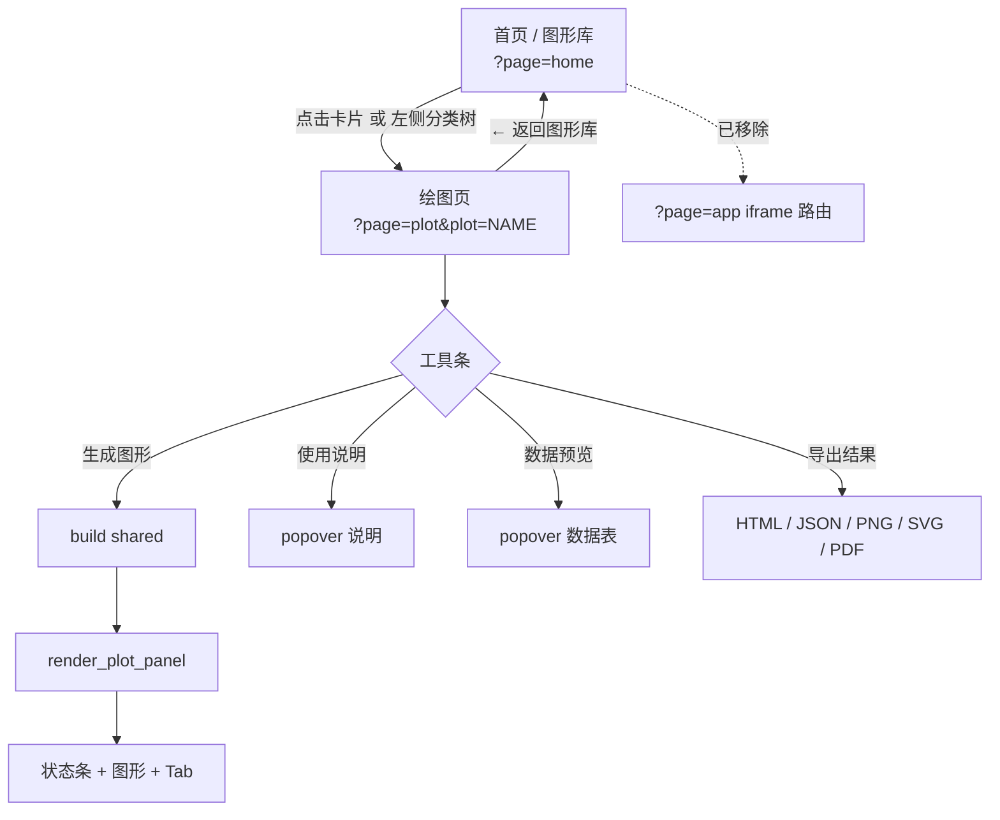

# PRD · 原生图库融合（Native Fusion）

> 增量需求文档。只描述本次变更，不重述已有 12 个模块的历史需求。

| 项 | 内容 |
|---|---|
| 文档版本 | v1.0（增量） |
| 产品 | BioPlotter · 生物数据可视化工作台 |
| 基线版本 | v2.1（12 个原生 Plotly 模块 + 5 个 iframe 外挂应用） |
| 目标版本 | v3.0 |
| 撰写人 | 许清楚（产品经理） |
| 技术栈基线 | Streamlit + Plotly（沿用，不引入新前端框架） |

---

## 1. 背景与问题

### 1.1 现状

当前站点存在**两套互不相通的图库体系**：

| 体系 | 实现 | 数量 | 渲染方式 |
|---|---|---|---|
| A · 原生模块 | `app/modules/*.py`，`controls(shared)` + `build(shared)` | 12 | Plotly 原生，站内渲染 |
| B · 交互应用 | `app/core/external.py` + `static/apps/` + `shiny_apps/` | 5 | `<iframe>` 嵌入独立服务 |

原有 5 个应用分别依赖：2 个 Vue 3 静态站点（Vite 构建产物）、3 个 R Shiny 服务（需本机 R 4.5 + 包环境）。站点通过 `run_shiny_apps.py` 拉起 4 个本地端口（8700 / 8601 / 8602 / 8603），再用 `components.iframe()` 嵌入。

### 1.2 问题（为什么放弃 iframe）

| # | 问题 | 影响 |
|---|---|---|
| P1 | **启动强耦合**：必须另起 4 个进程，`start_all.bat` 才能用；只跑 `start_app.bat` 时 5 个应用全部显示"服务未启动" | 新用户 100% 第一天就卡住，首屏即失败 |
| P2 | **三层嵌套布局**：Streamlit 页面 → iframe → 独立应用自己的 navbar/hero。滚动条嵌套、双导航栏、页面高度写死 `height=900~940` | 视觉割裂，无法做统一的顶部导航 + 左侧功能栏 |
| P3 | **主题不联动**：站内 Light/Dark 切换对 iframe 内部零影响；Vue/R 应用各自写死配色（`#73A8D0` 蓝、minty 主题） | 暗色模式下出现刺眼白色大块 |
| P4 | **导出割裂**：站内导出中心（HTML/JSON/PNG/SVG/PDF）对 iframe 完全失效，用户需在 iframe 内另找下载按钮，格式各不相同（jsPDF / ggsave / svglite） | 导出入口有 5 套，认知负担高 |
| P5 | **架构负担**：R + renv + manifest.json（单文件 400KB+）、Vue 构建产物（`static/apps/*/assets/` 数十个 hash 文件）全部入库 | 仓库臃肿、无法在纯 Python 环境部署 |
| P6 | **数据不出站**：iframe 内上传的数据无法被站内的"数据预览 / 示例数据下载 / 参数状态条"感知 | 站内统一体验无法闭环 |
| P7 | **维护双栈**：改一个配色要同时改 Python CSS、Vue SCSS、R ggplot theme | 每次迭代成本 ×3 |

### 1.3 本次变更的判定

用户明确要求：**不要外挂方式**，5 个模块要"完整重写为站内原生模块"，核心图形、主要参数与示例数据必须保留，不能用截图/iframe 冒充。

因此本次是**替换（replace）而非新增（add）**：5 个应用从 B 体系迁入 A 体系，B 体系整体下线。

---

## 2. 产品目标与非目标

### 2.1 产品目标

**G1 · 单进程可用**
纯 `streamlit run app.py` 一条命令，5 个新模块全部可交互出图，无任何外部服务、端口、R 环境依赖。

**G2 · 体验同构**
5 个新模块与现有 12 个模块在交互契约上完全一致：同一套 `controls()` / `build()` 接口、同一套侧栏参数区、同一个工具条（生成 / 说明 / 数据预览 / 导出）、同一套主题联动、同一种示例数据载入方式。

**G3 · 图库补全为"生信常用图谱"**
在 12 个特色图基础上，补齐 6 个高频基础图（Volcano / PCA / Heatmap / UpSet / Kaplan-Meier / Manhattan），让站点从"特色图专题站"升级为"日常生信出图工具"。

**G4 · 常规网页布局**
用「顶部导航栏 + 左侧功能栏 + 主内容区」替换现有「超大 hero + 卡片瀑布流」，视觉密度提升，信息层级从"营销展示"转为"工具使用"。

### 2.2 非目标（本期明确不做）

- ❌ 不引入云端后端、登录、数据库、用户体系（本地工具站定位不变）
- ❌ 不改动已有 12 个模块的绘图逻辑与参数
- ❌ 不实现 GIF 动画导出（Plotly 无原生能力，见 §5.1 简化项）
- ❌ 不实现 R `trackViewer` 的 GFF3 全量解析（147MB 级文件），只支持简化三列表
- ❌ 不做移动端 App / 桌面打包（PWA/Electron）
- ❌ 不做图库的分享链接、协作、收藏（无后端前提）
- ❌ 不重写 Plotly → 其他渲染引擎

---

## 3. 用户故事

| ID | 角色 | 故事 |
|---|---|---|
| US-01 | 湿实验出身的研究生 | 作为**第一次打开站点的用户**，我想在首页一眼看到所有图形按类别分组、有缩略图和一句话说明，以便**在不看文档的情况下判断哪个图适合我的数据**。 |
| US-02 | 生信分析人员 | 作为**要画火山图的用户**，我想从首页点进 Volcano Plot 后，左侧已经预填好示例数据和默认阈值（log2FC=1, p=0.05），点「生成图形」立刻看到结果，以便**先确认图形形态再换成自己的数据**。 |
| US-03 | 已有自己表格的用户 | 作为**手上有 CSV 的用户**，我想在左侧关闭「使用示例数据」并上传文件，系统能自动识别列名与类型（数值/分类），以便**不用改列名就能出图**。 |
| US-04 | 需要精调出版图的用户 | 作为**要投稿的用户**，我想在左侧调完阈值线、颜色、字号、图例位置后点「生成图形」，图形即时刷新且参数不丢失，以便**反复微调到可发表状态**。 |
| US-05 | 需要交付的用户 | 作为**要交报告的用户**，我想在「导出结果」里一次拿到高分辨率 PNG + 可交互 HTML + 配套示例数据结构，以便**同时满足 Word 插图与在线演示两种场景**。 |
| US-06 | 夜间使用的用户 | 作为**长时间使用的用户**，我想在顶部栏切换 Light/Dark，所有模块（含新迁移的 5 个）的底色、文字、网格线一起切换，以便**夜间不刺眼且不用逐模块调色**。 |
| US-07 | 笔记本外接小屏用户 | 作为**窄屏用户**，我想在 1024px 宽度下左侧参数栏可折叠、图形区自适应宽度不出现横向滚动条，以便**在 13 寸屏上也能完整调参出图**。 |
| US-08 | 从旧版迁移的用户 | 作为**用过旧版 BubbleViz 的用户**，我想在搜索框输入 "bubble" 或 "气泡" 都能找到对应模块，并看到原有核心参数（x/y/size/color/animation 映射、大小范围、透明度、形状），以便**不用重新学习**。 |
| US-09 | 做多组学整合的用户 | 作为**要在同一份数据上换视角的用户**，我想在「环形与极坐标」分类下同时看到环形热图（CircleViz，多环 + 网络）和环形柱（CircularBarPlot，玫瑰图），并各自按自己的数据格式上传，以便**按手头数据结构选到最合适的环形表达**。 |
| US-10 | 基因组方向的用户 | 作为**看变异位点的用户**，我想上传 gene structure（name/start/end）与 SNP（name/position/score）两张表，并通过起止区间过滤放大某一段，以便**聚焦目标区域而不是被全基因组压扁**。 |

---

## 4. 需求池（P0 / P1 / P2）

> 优先级定义：**P0 = 必须**（不做则本次变更不成立）；**P1 = 应该**（影响体验完整性）；**P2 = 可以**（有余量再做）。

### 4.1 P0 · 必须

| ID | 需求 | 说明 |
|---|---|---|
| P0-01 | 5 个模块原生化重写 | BubbleViz / Grouped Matrix Plotting / CircleViz / CircularBarPlot / Genomic Variation Viewer 全部实现 `controls(shared)` + `build(shared)`，返回 `(fig, data, status, help_text)`，`fig` 为 Plotly `go.Figure` |
| P0-02 | 5 个模块示例数据入库 | 在 `sample_data/` 新增对应 CSV，注册进 `SAMPLE_PATHS`；数据内容取自原项目真实示例（见 §5 各模块） |
| P0-03 | 5 个模块首页预览图 | `app/assets/previews/` 复用现有 5 张 SVG（`bubbleviz/gmp/circleviz/circularbar/genvar.svg`），并在 `catalog.py` 注册 `PlotMeta` |
| P0-04 | 统一导出 | 5 个模块走现有 `render_export_popover()`：HTML / JSON 必出；PNG / SVG / PDF 依赖 kaleido，缺失时降级提示 |
| P0-05 | 主题联动 | 5 个模块默认色从 `THEMES[theme]` 读取，切换主题后 `reset_module_colors()` 清理自定义色 |
| P0-06 | 清理外部应用入口 | 删除 `app/core/external.py`、`static/apps/`、`shiny_apps/`、`run_shiny_apps.py/.bat/.sh`、`start_all.bat`；移除 `app.py` 中 `EXTERNAL_APPS` / `show_app` / `render_shiny_launcher` / `open_app` / `?page=app` 路由 |
| P0-07 | 新增 6 个生信图模块 | Volcano / PCA / Heatmap / UpSet / Kaplan-Meier / Manhattan，同样实现原生模块三件套（controls/build/示例数据/预览图） |
| P0-08 | 常规网页布局重构 | 顶部品牌导航栏 + 左侧功能栏 + 主内容区；移除首页 hero 大区块，改为紧凑页头 |
| P0-09 | 图库分类体系扩展 | 由 3 类扩到 6 类，`CATEGORY_ORDER` 更新，23 个模块全部归位（见 §7.1） |

### 4.2 P1 · 应该

| ID | 需求 | 说明 |
|---|---|---|
| P1-01 | 顶部导航栏含主题切换 | 把主题选择器从侧栏移到顶栏右侧，全局生效 |
| P1-02 | 左侧功能栏可折叠 | Streamlit 原生 sidebar 折叠即可，但需保证折叠后主内容不出现横向滚动 |
| P1-03 | 图库密度提升 | 首页由 3 列大卡片改为 4 列紧凑卡片（≥1440px）/ 3 列（≥1024px）/ 2 列（<1024px） |
| P1-04 | 搜索增强 | 搜索命中范围加入模块原名（"BubbleViz"、"GMP"、"CircleViz"）与中文别名（气泡图/环形热图/棒棒糖图） |
| P1-05 | 绘图页右侧信息密度 | 「数据预览 / 使用说明」由 popover 改为绘图区下方 tab（图形 / 数据 / 说明），减少点击层级 |
| P1-06 | 迁移提示 | 首次进入 5 个新模块时，`status` 中带上"已升级为站内原生版本，原 iframe 版本已下线" |
| P1-07 | 示例数据打包下载 | 多文件输入的模块（CircleViz 单文件、GenVar 双文件）支持 zip 打包下载示例 |

### 4.3 P2 · 可以

| ID | 需求 | 说明 |
|---|---|---|
| P2-01 | 模块内"重置为默认参数" | 每个模块侧栏底部一个重置按钮 |
| P2-02 | 导出预设尺寸 | PNG 导出可选 1x/2x/3x（对应 plotly `scale`） |
| P2-03 | 图库收藏/最近使用 | 仅用 `session_state`，不落盘，刷新即失效 |
| P2-04 | CircleViz 柱状图独立 tab | 第 4 维度（data4）单独出一个柱状图面板，而非挤在同一张环图里 |
| P2-05 | 键盘可达性 | 侧栏 Tab 顺序、按钮 focus 可见 |

---

## 5. 5 个重写模块 · 必须保留能力 vs 可以简化项

### 5.1 BubbleViz → 原生 Bubble Plot

**原始实现**：Vue 3 + ECharts，6 步向导（Upload → Select → Mode → Map → Generate → Adjust），generate 出 static / animated / both 三种图。

**输入**：CSV / XLSX。列映射 4 或 5 个维度：`x`（数值）、`y`（数值）、`size`（数值，>0）、`color`（分类）、`animation`（可选，分类/时间）。

**示例数据**（必须入库）：

| 文件 | 列 | 建议默认映射 |
|---|---|---|
| `bubble_country.csv`（原 `data1.csv`，231 行） | Country, Continent, Year, Life expectancy, Population, GDP per capita | x=GDP per capita, y=Life expectancy, size=Population, color=Continent, animation=Year |
| `bubble_aqi.csv`（原 `data2.csv`，47 行） | Date, City, AQI, PM2.5, SO2 | x=PM2.5, y=AQI, size=SO2, color=City（静态） |

**必须保留能力**

1. 4 维静态映射：x / y / size / color
2. 第 5 维动画映射：`animation` 列驱动逐帧动画，带播放条（Plotly `px.scatter(animation_frame=..., animation_group=...)`）
3. 气泡大小 **log10 归一化** + 可调 `min_size`(5~20) / `max_size`(40~100)
4. 透明度 0.2~1.0
5. 气泡形状：circle / square / triangle（Plotly marker symbol：circle / square / triangle-up）
6. X 轴 log10 变换开关
7. 分组多选筛选（最多 5 组）+ 每组独立配色
8. 图表标题、X 轴标题、Y 轴标题
9. 宽高比 16:9 / 2:1 / 4:3 / 3:4
10. 静/动两种模式切换

**可以简化项**

| 简化 | 原因 |
|---|---|
| 6 步向导 → 单页侧栏分组（数据 / 映射 / 外观 / 动画） | Streamlit 侧栏天然是扁平表单；保留"引导式"文案即可 |
| GIF 动画导出 | Plotly 无法直出 GIF；改为"HTML 动画 + 当前帧 PNG" |
| jsPDF 客户端 PDF | 归入现有导出中心（kaleido） |
| "透明度模式"（源码中 `isOpacityMode` 已恒为 `false` 的死代码） | 原版已废弃，不予实现 |
| 大小双区段非线性缩放算法 | 用 log10 线性映射替代，视觉差异可忽略 |
| `both`（同屏静态 + 动态）模式 | 收敛为两种模式单选，避免同页两张图 |

---

### 5.2 Grouped Matrix Plotting（GMP）→ 原生 Grouped Categorical Matrix

**原始实现**：Vue 3 + 手写 SVG（3823 行单文件），20+ 个折叠面板。

**图形语义**：**分类矩阵点阵图**。Y 轴为行实体（Virus 24…），按 Group 分组，Y 轴左侧画分组色块 + 分组名；X 轴为分类列（Seg1…Seg8）；单元格取值是**类别**（Known / Novel_Annotated / Novel_Not_Annotated / 空），用"形状 + 填充色 + 描边"表示。

**输入**（长表）：`row`（行名）/ `group`（Y 轴分组）/ `column`（X 轴列名）/ `category`（类别，可为空）。
**示例数据**：`gmp_virus_matrix.csv` — 26 行 Virus × 8 列 Seg，3 个类别 + 空值，6 个分组（Group1~Group6）。

**必须保留能力**

1. Y 轴按 `group` 分组：左侧分组色块 + 分组名文字 + 行标签
2. 每格一个符号，符号形状按 `category` 映射（circle / square / star / triangle / triangle-down / diamond 六选 N）
3. 类别填充色可配（默认 Known `#FFC9F2` / Novel_Annotated `#B8ECFF` / Novel_Not_Annotated `#B6FCBF`）
4. 图例：类别图例 + 分组色块图例，可开关
5. 网格细线 + 外框（单线 / 双线可切换）
6. 符号大小、字体大小、画布宽高（默认 750×620）、分组标签列宽（默认 120）
7. 标题、X 轴标题、Y 轴标题
8. 导出 SVG / PNG

**可以简化项**

| 简化 | 原因 |
|---|---|
| 20+ 折叠面板逐元素 color picker（标题色 / 轴标题色 / X 轴文字色 / 首列文字色…） | 收敛为 5 个：类别色 ×3 + 分组色（自动生成）+ 边框色 |
| 右侧 20+ 个逐格可编辑数据 tab | 只保留"数据预览 + 下载示例数据" |
| 内置 JS 对 SVG 做二次后处理（`data-type` 属性回写样式） | Plotly 原生 `marker.symbol` + `marker.color` 直接出图 |
| 7 组硬编码分组色 `Group1..Group7` | 按数据实际分组数自动从调色板取色 |
| 分页 / 搜索 / 每页 10 条的数据表 | 预览只显示前 200 行（沿用 `_render_frame`） |

---

### 5.3 CircleViz → 原生 Circular Heatmap + Ring Network

**原始实现**：R Shiny + ggraph/ggplot2 + bs_theme(minty)，36KB app.R。

**图形语义**：**三层同心环 + 环形网络**。
- 内环：`data1`（分类字符，每个字符一个颜色）
- 中环：`data2`（数值，low/mid/high 三色渐变）
- 外环：`data3`（数值，low/mid/high 三色渐变）
- 环形网络：从 `name` 前缀（如 `Cis` / `Ctrl`）提取 `type` 作为**中心节点**，各 `name` 作为圆周**普通节点**，中心↔普通连线
- 中心文字：分组名

**输入**（固定 6 列，列名可任意但顺序固定）：`id`(序号) / `name`(中心名-实体名) / `data1`(字符，≤5 个指标，空值允许) / `data2`(数值) / `data3`(数值) / `data4`(数值 0~20，柱状图用)
**示例数据**：`circleviz_cis_ctrl.csv` — 51 行（Cis-1~Cis-42 + Ctrl-1~Ctrl-9）。

**必须保留能力**

1. 严格 6 列格式解析（顺序固定，列名忽略）
2. 从 `name` 前缀提取 `type`，作为中心节点；`Cis` / `Ctrl` 两类
3. 环形网络：中心节点 + 圆周节点 + 连线；`center_size` / `normal_size` / `edge_width` / `transparency` 四参数
4. 节点形状 5 选：circle / square / lozenge / up-triangle / down-triangle
5. 三层同心环：内环（分类）/ 中环（数值）/ 外环（数值），每层**高度独立可调**（0~1）
6. 中环、外环各三色（low / mid / high）
7. 内环每类别独立配色（按 `data1` 实际出现的类别自动生成取色器）
8. 图例开关
9. 两种排序：按 `data4` 数值升序 / 按 `name` 分组升序
10. 中心文字标签（分组名）
11. 导出（原为 PDF，站内改为 PNG / SVG / PDF / HTML）

**可以简化项**

| 简化 | 原因 |
|---|---|
| 动态生成的 `colourInput` 列表（每类别一个） | 保留但收敛到 1 个 `st.expander("内环类别配色")`，超过 8 个类别只显示前 8 个 |
| 柱状图（`data4`）作为独立第 4 图 | **P2**：先以"外挂径向柱（第 4 环）"或独立 tab 承接，避免一张图过载 |
| 字体类型 6 选（serif/SimHei/mono/Arial/Times/SimSun） | 保留 4 选，`_safe_font()` 做可用性兜底 |
| `image1.png` / `image2.png` 首页展示图 | 首页改为紧凑布局后不再需要 |
| bs_theme 的 minty 全局皮肤 + 100+ 行 `!important` CSS | 统一由站点主题系统接管 |

---

### 5.4 CircularBarPlot → 原生 Circular / Faceted Bar

**原始实现**：R Shiny + ggplot2 `coord_polar` + facet，42KB app.R。

**图形语义**：同一份数据的**两个视图** —— 极坐标环形柱（玫瑰图，带中心分组文字、外圈基因标签、预留扇区刻度）+ 普通分组条形图（facet by type，正负双向、星号标注）。

**输入**：`Name`(必须，基因名) / `type`(必须，分组) / `data`(必须，响应比值，可正可负，NA 允许) / `p_value`(可选) / `num_stars`(可选，整数)。列名不区分大小写，按别名自动匹配。
**示例数据**：`circularbar_genes.csv` — 36 基因（G1~G36）× 3 组（A/B/C），含 `p_value` 与 `num_stars`，约 10% 缺失值。

**必须保留能力**

1. 双视图切换：环形图（极坐标柱）/ 条形图（分面）
2. 正负值双色映射：`≥0` 与 `<0` 各一色；`NA` 单独一色
3. 按 `type` 分组的组间间隔 + 中心分组文字
4. 组内排序：不排序 / 按数值降序 / 按数值升序（**NA 排在组末**）
5. 显著性星号：优先用 `num_stars` 列；否则由 `p_value` 推算（p<0.001→3★，p<0.01→2★，p<0.05→1★，NA→0）；正值置柱顶、负值置柱底
6. 环形参数：起始角度（默认 270°）、外层圆半径（y 上限，默认 1）、空心圆半径（y 下限，默认 -0.5）、标签距外圈距离（默认 0.1）
7. 条形参数：柱宽（默认 0.7）、X 轴标签角度（默认 45°）、基因标签显隐
8. 字号：基因标签 / 中心文字 / 刻度标签 / 坐标轴文字 / 坐标轴标题 / 分面标题 / 星号 / 图例
9. 字体族 6 选（默认 / Times New Roman / Arial / KaiTi / SimSun / SimHei）
10. 导出 PDF / PNG / SVG + 画布宽高（4~20 英寸）
11. 数据预览 + 当前数据 CSV 下载

**可以简化项**

| 简化 | 原因 |
|---|---|
| 「生成随机数据」按钮 + `n_genes` 8~200 滑杆 | 保留按钮但固定 36 基因 / 3 组，去掉数量输入 |
| 10+ 个逐元素 color picker（分面标题色 / 刻度标签色 / 坐标轴标题色 / 图例文字色…） | 收敛为 5 个：正值 / 负值 / 分组色（自动）/ 星号 / NA |
| 每个参数一个 `?` 帮助浮层（`actionLink("help_*")`） | 统一并入右上「使用说明」 |
| 画布宽高 4~20 英寸逐档 | 改为连续 number_input |
| `DT::datatable` 交互表 | 改为 `st.dataframe` |

---

### 5.5 Genomic Variation Viewer → 原生 Genomic Track (Lollipop / Dandelion)

**原始实现**：R Shiny + Bioconductor `trackViewer`，69KB app.R。

**图形语义**：**基因组变异轨道图**。以基因组坐标为 X 轴，串联三条轨道：上层 SNP 棒棒糖轨道 / 中层基因结构区间块 / 下层 SNP 棒棒糖轨道（dandelion 模式压缩为单层从中心向外发散的棒棒糖）。

**输入**（2~3 个 CSV，无表头，三列）：

| 表 | 列 | 示例 |
|---|---|---|
| Gene Structure | `name, start, end` | block1,1,80 / block2,261,360 / block3,501,830 |
| Upper SNP | `name, position, score(可选)` | snp10,10 / snp102,102 |
| Lower SNP（仅 lollipop） | 同 Upper | snp206,206 |

**示例数据**：`genvar_feature.csv`（3 行）、`genvar_snp_upper.csv`（10 行）、`genvar_snp_lower.csv`（9 行），均取自原 app 内置示例。

**必须保留能力**

1. 双模式：Lollipop Plot（上下双层 SNP）/ Dandelion Plot（单层发散）
2. 基因结构轨道：按 `start/end` 画区间矩形块，块高可调（0.02~0.15，默认 0.04）
3. SNP 棒棒糖：垂直线 + 头部标记，位置由 `position` 决定
4. 显示区间过滤：`start` / `end` 两个输入 + 「恢复全区间」按钮
5. SNP 大小三模式：统一（0.5~2，默认 1）/ 随机 / 自定义（label→size 映射）
6. SNP 颜色两模式：随机 / 单色（默认 `#98CE31`）+ 单点覆盖（label→color）
7. SNP 标签显隐 + 单点标签文字色覆盖
8. X 轴显隐
9. 导出 PDF / JPG（站内改为 PNG / SVG / PDF / HTML）
10. 数据预览（Gene Structure 表 + SNP 表分开显示）

**可以简化项**

| 简化 | 原因 |
|---|---|
| `trackViewer` 的 `pin` / `flag` 特殊图形 | 只保留 circle / flag 两种，pin 用 circle + 短杆近似 |
| 三套独立的「添加 / 清空」配置 UI（custom sizes、single colors、label text colors） | 合并为 1 个「逐项覆盖」表格：3 列（label / size / color），一次编辑三件事 |
| GFF3 全量解析（原 `data/NDH108_v1.gff3` 147MB） | 只支持三列简化 CSV，不做 GFF3 解析 |
| Dandelion 与 Lollipop 两套独立数据加载分支 | 共用同一份 SNP 表，仅渲染方式不同 |
| `download_plot_format` 只有 PDF/JPG | 走统一导出中心 |

---

## 6. 新增 6 个生信图 · 选择与输入格式

### 6.1 选择理由

从候选集中选出 6 个。候选：Volcano / PCA / Heatmap / UpSet / Kaplan-Meier / Manhattan / MA Plot / ROC / Venn；**选中前 6 个**，理由如下，剔除项见后。

| # | 图形 | 分类 | 选择理由 | 与现有图库的关系 |
|---|---|---|---|---|
| N1 | **Volcano Plot** | 统计与富集 | 差异表达分析第一产出图，使用频率最高；与现有 GO Enrichment 构成"差异 → 富集"完整链路 | 互补（GO 只画富集结果，不画差异） |
| N2 | **PCA** | 统计与富集 | 样本 QC / 批次效应 / 分组分离的必备首图，几乎所有组学项目都会画 | 全新能力（现无降维图） |
| N3 | **Heatmap** | 矩阵与热图 | 表达矩阵 + 双向聚类的主力图；GMP 是**分类矩阵**，Heatmap 是**连续数值矩阵**，两者正交不重复 | 互补（GMP 无法表达连续值梯度） |
| N4 | **UpSet Plot** | 矩阵与热图 | 4 组以上集合交集的标准解法，替代 Venn 图；基因集/OTU/变异集合分析高频 | 全新能力 |
| N5 | **Kaplan-Meier** | 基因组与生存 | 临床预后 / 生存分析的标配图，带风险表与 log-rank p 值 | 全新能力（现无生存分析） |
| N6 | **Manhattan Plot** | 基因组与生存 | GWAS / 选择信号标准图；与 Genomic Variation Viewer 共同构成"基因组坐标轴"叙事 | 互补（GenVar 画单区域轨道，Manhattan 画全基因组散点） |

**剔除说明**
- **MA Plot**：与 Volcano 信息高度重叠（同一 log2FC 数据的不同投影），同时上线会让用户困惑选哪个 → 不做。
- **ROC**：偏临床诊断模型评估，与"组学数据可视化"主线弱相关 → 不做。
- **Venn**：超过 4 组无法阅读，UpSet 是其超集 → 用 UpSet 覆盖。

### 6.2 输入数据格式

| 图 | 必须列 | 可选列 | 示例文件 | 关键技术点 |
|---|---|---|---|---|
| **Volcano Plot** | `gene`(名称) / `log2FC`(数值) / `pvalue`(数值 0~1) | `padj`、`label`(是否标注)、`group`(上调/下调/不显著，缺省自动推断) | `volcano_degs.csv`（约 3000 行） | -log10(p) 为 Y 轴；阈值线 `log2FC=±1`、`p=0.05` 可调；上/下/不显著三色；Top-N 标注 |
| **PCA** | 第 1 列样本名 + 其余为数值特征列（宽表） | `group`（样本分组，用于着色与置信椭圆） | `pca_samples.csv`（30 样本 × 500 特征） | 标准化 → SVD → PC1/PC2（可切 PC 序号）；解释方差比写入轴标题；`plotly.express.scatter` + 椭圆 |
| **Heatmap** | 第 1 列行名 + 其余为数值列（宽表矩阵） | 行分组列 / 列分组列 | `heatmap_expression.csv`（200 基因 × 20 样本） | z-score 按行标准化；可选行/列层次聚类（scipy `linkage`）；色阶可选中点与发散色；`go.Heatmap` |
| **UpSet Plot** | 长表：`set`(集合名) / `element`(元素名) | — | `upset_genesets.csv`（5 集合 × 200 元素） | 或接受 0/1 宽表；交集按大小降序取 Top-15；上方交集柱 + 左侧集合总量条 + 下方点阵矩阵（3 个 subplot 组合） |
| **Kaplan-Meier** | `sample` / `time`(数值>0) / `status`(0/1 或 dead/alive) / `group` | `age`、`sex` 等协变量 | `km_survival.csv`（180 例 × 2 组） | 阶梯曲线（`line_shape='hv'`）+ 删失标记（+）+ 风险表（可选）+ log-rank p（scipy 手算或 lifelines 可选） |
| **Manhattan Plot** | `snp`(ID) / `chr` / `pos`(数值) / `pvalue` | `gene`（标注） | `manhattan_gwas.csv`（约 5000 SNP × 5 染色体） | 按染色体分色 + 交替灰蓝；累积坐标避免染色体间断；`-log10(p)` 为 Y；显著阈值线（`5e-8`，可调）；Top-N 标注 |

**依赖说明**：Heatmap 聚类与 KM 曲线均可用现有依赖（`scipy` + `numpy` + `plotly`）实现，**无需新增第三方包**；`lifelines` 若安装则用于精确 log-rank，未安装则用内置实现降级，不写入 `requirements.txt` 强制依赖。

---

## 7. UI 信息架构与页面布局

### 7.1 信息架构

```
BioPlotter v3.0
├── 顶部导航栏（全站固定）
│   ├── 品牌区：Logo + BioPlotter + v3.0
│   ├── 主导航：图形库 / 快速开始 / 关于
│   └── 右侧：搜索框 · 主题切换（Light/Dark）· 模块计数
├── 左侧功能栏（随页面变化）
│   ├── 【图库页】分类树（6 类 / 23 模块，可折叠） + 分类计数
│   └── 【绘图页】返回图库 / 模块信息卡 / 示例数据开关 / 参数分组（数据·外观·标注·导出）
└── 主内容区
    ├── 【图库页】页头（标题 + 一句话 + 统计 chip）→ 分类 Tab → 紧凑卡片网格
    └── 【绘图页】面包屑 → 图标题行 → 工具条 → 状态 chip → 图形 → Tab（数据/说明）
```

**6 个分类与归属（23 个模块）**

| 分类 | 数量 | 模块 |
|---|---|---|
| 网络关系 | 5 | Arc Diagram、Hierarchical Edge Bundling、Chord Diagram、Node-link Diagram、Sankey |
| 分布比较 | 6 | Raincloud Plot、Beeswarm、Split Violin、ScaBoxDen、Pirate Plot、**BubbleViz** |
| 矩阵与热图 | 3 | **Grouped Matrix Plotting**、**Heatmap**、**UpSet Plot** |
| 环形与极坐标 | 2 | **CircleViz**、**CircularBarPlot** |
| 统计与富集 | 4 | Mantel Test、GO Enrichment、**Volcano Plot**、**PCA** |
| 基因组与生存 | 3 | **Genomic Variation Viewer**、**Manhattan Plot**、**Kaplan-Meier** |

> 加粗 = 本次新增或迁移。

### 7.2 图库页线框

```
┌──────────────────────────────────────────────────────────────────────────────────┐
│ ▣ BioPlotter  v3.0      图形库   快速开始   关于      [🔍 搜索图形…]  ☀ Light     │  ← 顶部导航栏 56px
├────────────────┬─────────────────────────────────────────────────────────────────┤
│ 图形库  23      │  图形库                                    23 个模块 · 6 类 · 30 份示例│
│                │  23 个可交互出图模块，全部站内原生渲染                          │
│ ▾ 网络关系   5  │                                                                 │
│   Arc Diagram  │  [全部] [网络关系] [分布比较] [矩阵与热图] [环形与极坐标]         │
│   HEB          │  [统计与富集] [基因组与生存]                                     │
│   Chord        │                                                                 │
│   Node-link    │  ┌────────────┬────────────┬────────────┬────────────┐            │
│   Sankey       │  │ [SVG 预览] │ [SVG 预览] │ [SVG 预览] │ [SVG 预览] │            │
│ ▾ 分布比较   6  │  │ PLOTLY     │ PLOTLY     │ PLOTLY     │ PLOTLY     │            │
│   Raincloud    │  │ Arc Diagram│ BubbleViz  │ Heatmap    │ Volcano    │            │
│   Beeswarm     │  │ 一句话说明 │ 一句话说明 │ 一句话说明 │ 一句话说明 │            │
│   …            │  │ 输入：…    │ 输入：…    │ 输入：…    │ 输入：…    │            │
│ ▸ 矩阵与热图 3  │  │ 打开绘图 → │ 打开绘图 → │ 打开绘图 → │ 打开绘图 → │            │
│ ▸ 环形与极坐标 2│  └────────────┴────────────┴────────────┴────────────┘            │
│ ▸ 统计与富集 4  │  ┌────────────┬────────────┬────────────┬────────────┐            │
│ ▸ 基因组与生存 3│  │    …       │    …       │    …       │    …       │            │
│ ──────────────  │  └────────────┴────────────┴────────────┴────────────┘            │
│ v3.0 · 原生渲染  │                                                                 │
└────────────────┴─────────────────────────────────────────────────────────────────┘
   ↑ 左侧功能栏 240px      ↑ 主内容区（自适应，max-width 1440px）
```

**变化点（相对现状）**

| 现状 | v3.0 |
|---|---|
| 首页顶部超大 hero（2.1rem 标题 + 渐变背景 + 4 个统计卡） | 移除 hero，改为 1 行页头（标题 1.3rem + 一句话 + 3 个 inline 统计 chip） |
| 3 列大卡片（`min-height: 156px` 卡体 + `aspect-ratio: 5/3` 预览） | **4 列紧凑卡片**（卡体 ≥110px，预览 `aspect-ratio: 16/10`），≥1440px 4 列 / ≥1024px 3 列 / <1024px 2 列 |
| 侧栏混排"图形库"+"交互应用"两段 | 只保留 6 类分类树，分类可折叠（`st.expander` 或 details） |
| 分类用 `st.radio` 横向排列 | 分类用顶部 pill Tab，与左侧分类树联动 |
| 主题选择器在侧栏顶部 | 移到**顶部导航栏右侧** |

### 7.3 绘图页线框

```
┌──────────────────────────────────────────────────────────────────────────────────┐
│ ▣ BioPlotter  v3.0      图形库   快速开始   关于      [🔍 搜索图形…]  ☾ Dark      │
├────────────────┬─────────────────────────────────────────────────────────────────┤
│ ← 返回图形库    │  图形库 / 统计与富集 / Volcano Plot                             │
│ [Light ▾]      │  Volcano Plot                                   [统计与富集]      │
│                │  差异表达火山图：log2FC 对 -log10(p)，标出上调/下调基因。        │
│ ┌────────────┐ │  ● 已生成  数据 3,000 行×3 列  引擎 Plotly  更新 14:32  主题 Light │
│ │Volcano Plot│ ├─────────────────────────────────────────────────────────────────┤
│ │统计与富集   │ │ [生成图形]  [使用说明]  [数据预览]  [导出结果]                  │
│ │gene/log2FC…│ │                                                                 │
│ └────────────┘ │  ┌───────────────────────────────────────────────────────────┐  │
│                │  │                                                           │  │
│ ☑ 使用示例数据  │  │                    Volcano 散点图                          │  │
│   sample_data/ │  │              （Plotly 交互画布，自适应宽度）                │  │
│   volcano_degs │  │                                                           │  │
│   .csv         │  │                                                           │  │
│ [载入示例并绘图]│  └───────────────────────────────────────────────────────────┘  │
│                │                                                                 │
│ ▾ 数据设置      │  ┌─ 图形 ─┬─ 数据预览 ─┬─ 使用说明 ────────────────────────┐  │
│   列映射 select │  │        │  3000 行 × 3 列  ·  st.dataframe           │  │
│ ▾ 阈值与标注    │  └────────┴────────────┴───────────────────────────────────┘  │
│   log2FC 阈值   │                                                                 │
│   p 阈值        │                                                                 │
│   Top-N 标注    │                                                                 │
│ ▾ 外观          │                                                                 │
│   上调/下调/NS  │                                                                 │
│   点大小/透明度 │                                                                 │
│ ▸ 标题与坐标轴  │                                                                 │
│                │                                                                 │
│ [重置默认参数]  │                                                                 │
│ ──────────────  │                                                                 │
│ v3.0 · 原生渲染  │                                                                 │
└────────────────┴─────────────────────────────────────────────────────────────────┘
```

**关键交互契约（与现有 12 个模块保持一致，不得偏离）**

| 契约 | 说明 |
|---|---|
| 侧栏调用 | `render_plot_sidebar(module_obj, meta)` → `module_obj.controls(st.session_state)` |
| 出图调用 | `run_module_generation(plot_name, module_obj)` → `module_obj.build(shared)` |
| 返回签名 | `build()` 返回 `(fig, data, status, help_text)`，可 4 元组、单 fig、或只写 `shared["last_plotly"]` |
| 首次进入 | 自动用示例数据出图一次（`auto_need_generate` 逻辑沿用） |
| 状态条 | `render_meta_strip()` 显示 状态/数据/引擎/更新/主题 |
| 导出 | `render_export_popover(meta)`，Plotly 分支支持 HTML/JSON(+PNG/SVG/PDF) |
| 主题清理 | 模块自定义色 key 前缀需加入 `reset_module_colors()` 的 `prefixes` 列表 |

**技术约束（实现必须遵守）**

1. Streamlit 原生 `stHeader` 无法承载复杂导航 → **隐藏默认 header**（`[data-testid="stHeader"] {display:none}`），用 `st.markdown(unsafe_allow_html=True)` 在主容器顶部渲染自定义顶栏，并用 CSS `position: sticky; top: 0; z-index: 999` 吸顶。
2. 左侧功能栏**必须复用 Streamlit `st.sidebar`**（而非自绘 div），否则折叠、滚动、移动端抽屉等行为需全部重写。样式沿用现有 `[data-testid="stSidebar"]` 深色皮肤。
3. 顶栏与侧栏的**高度对齐**：顶栏 56px；侧栏 `padding-top` 需扣除顶栏高度，避免内容被遮挡。
4. 卡片网格用 `st.columns(4)` + `gap="medium"`；响应式靠现有 `@media` 断点控制列数（Streamlit 的 columns 在窄屏会自动堆叠，需额外 CSS 保证 1024px 仍为 3 列）。
5. `reset_module_colors()` 需补充 11 个新前缀（`bubble_`、`gmp_`、`circle_`、`cbar_`、`genvar_`、`volcano_`、`pca_`、`heatmap_`、`upset_`、`km_`、`manhattan_`），否则主题切换后新模块颜色不重置。

### 7.4 Mermaid · 页面流转



---

## 8. 验收标准

### 8.1 功能验收（可测试）

| # | 验收项 | 通过判据 | 验证方式 |
|---|---|---|---|
| AC-01 | 单进程可用 | 在**干净 venv** 中 `pip install -r requirements.txt && streamlit run app.py`，不启动任何 R / 额外进程，5 个迁移模块 + 6 个新增模块全部能出图 | 手动：新建 venv 跑一遍 |
| AC-02 | 无 iframe 残留 | 全仓库 `grep -r "components.iframe\|EXTERNAL_APPS\|run_shiny_apps\|shiny_apps\|static/apps"` 命中数为 **0** | grep |
| AC-03 | 无 R 依赖 | `shiny_apps/`、`manifest.json`、`renv/`、`run_shiny_apps.*`、`start_all.bat` 均已删除；`requirements.txt` 不含任何 R 相关 | 文件列表 |
| AC-04 | 模块数量 | `PLOTS` 字典长度为 **23**（12 原有 + 5 迁移 + 6 新增），`CATEGORY_ORDER` 长度为 **6** | `python -c "from app.core.catalog import PLOTS, CATEGORY_ORDER; print(len(PLOTS), len(CATEGORY_ORDER))"` |
| AC-05 | 接口一致性 | 23 个模块全部具备 `controls` 与 `build` 可调用属性，`build()` 对示例数据返回非 `None` 的 Plotly Figure | 遍历 `MODULES` 断言 |
| AC-06 | 示例数据完整 | 每个模块的 `meta.sample_keys` 中所有 key 在 `SAMPLE_PATHS` 存在且文件非空（≥1 行数据） | 遍历断言 |
| AC-07 | 预览图完整 | 每个模块的 `preview_svg(name)` 返回长度 > 200 的字符串，且能被 HTML 内联渲染 | 遍历断言 |
| AC-08 | 导出可用 | 每个 Plotly 模块的「导出结果」在已装 kaleido 时能产出 PNG/SVG/PDF；未装 kaleido 时只显示 HTML/JSON 且给出明确提示，不抛异常 | 手动抽 3 个模块 + 断言 `kaleido_available()` 分支 |
| AC-09 | 主题联动 | 切换 Light→Dark 后，23 个模块的图形底色/文字色随主题变化；再次切回 Light 恢复默认（模块自定义色被清除） | 手动抽 5 个模块 |
| AC-10 | 搜索命中 | 至少 5 个关键词能命中对应模块：`bubble` / `气泡` / `volcano` / `火山` / `环形`（另 `heatmap`、`热图`、`km`、`生存` 亦应命中） | 手动 + `search_plots()` 单元断言 |
| AC-11 | 首次进入自动出图 | 从首页点击任一模块，无需点「生成图形」即显示图形，且状态条为"已生成" | 手动遍历 23 个模块 |
| AC-12 | 空数据容错 | 关闭示例数据开关且未上传文件时，点「生成图形」显示"请先上传数据文件"类提示，不抛异常、不白屏 | 手动抽 5 个模块 |
| AC-13 | 上传容错 | 上传列名不符的 CSV（如缺 `log2FC`），显示含缺失列名的错误提示，页面仍可继续操作 | 手动抽 3 个模块 |
| AC-14 | 参数保持 | 调整侧栏参数后点「生成图形」，图形更新且侧栏参数值不重置 | 手动抽 3 个模块 |

### 8.2 UI 验收（可量化）

| # | 验收项 | 通过判据 |
|---|---|---|
| AC-15 | 首页无 hero | 页面 DOM 中不存在 `class="hero"`；首屏可见内容顶部到第一个卡片预览图的垂直距离 ≤ 340px（1440×900 视口） |
| AC-16 | 顶栏吸顶 | 页面向下滚动 800px 后，顶栏仍然可见（`getBoundingClientRect().top === 0`），高度 56±4px |
| AC-17 | 布局三区 | 1440px 视口下：左侧栏宽度 240±20px；主内容区宽度 ≥ 1100px；无横向滚动条（`document.documentElement.scrollWidth <= innerWidth`） |
| AC-18 | 卡片密度 | 1440px 视口下首页一屏（900px 高）可见卡片数 ≥ 8 个 |
| AC-19 | 窄屏适配 | 1024px 视口：左侧栏可折叠，折叠后主内容区无横向滚动；卡片 3 列 |
| AC-20 | 极窄屏适配 | 768px 视口：卡片 2 列，图表宽度撑满且无横向滚动条 |
| AC-21 | 主题完整 | Dark 模式下页面无纯白 `#ffffff` 大面积色块（允许 ≤ 2 处小面积）；文字对比度 ≥ 4.5:1 |
| AC-22 | 分类联动 | 左侧分类树点击某类，主内容区滚动到该分类锚点或过滤为该类；顶部 pill Tab 同步高亮 |

### 8.3 性能验收

| # | 验收项 | 通过判据 |
|---|---|---|
| AC-23 | 首页首屏 | 冷启动 `streamlit run` 后首页可交互时间 ≤ 5s（本机，23 个模块，17+6 张 SVG 内联） |
| AC-24 | 出图时延 | 示例数据下，任一模块点「生成图形」到图形出现 ≤ 3s（火山图 3000 行 / 热图 200×20 / Manhattan 5000 点） |
| AC-25 | 大文件容错 | 上传 5MB CSV（≥5 万行）的火山图，出图 ≤ 8s 或给出"数据量过大"的明确提示，不得浏览器卡死 |
| AC-26 | 包体积 | `app/assets/previews/*.svg` 每张 ≤ 4KB；`sample_data/` 新增文件合计 ≤ 3MB |

### 8.4 文档验收

| # | 验收项 | 通过判据 |
|---|---|---|
| AC-27 | README 同步 | README 中不再出现"5 个交互应用""R Shiny""run_shiny_apps""start_all"；模块数改为 23，分类改为 6 类 |
| AC-28 | 启动方式 | README 的"快速开始"只剩一条 `streamlit run app.py`（含 venv 创建），无第二进程 |
| AC-29 | 数据格式说明 | README 或 docs 中列出 11 个新模块的输入数据格式表（与 §5、§6.2 一致） |

---

## 9. 待确认问题

1. **模块显示名是否需要保留原样？** PRD 暂定沿用 `BubbleViz` / `Grouped Matrix Plotting` / `CircleViz` / `CircularBarPlot` / `Genomic Variation Viewer` 作为 `meta.name` 以保留用户认知（同时把中文别名放进 `tags` 供搜索）。是否要改成与其他模块一致的英文图表名（如 `Bubble Plot` / `Grouped Matrix` / `Circular Heatmap`）？

2. **CircleViz 的第 4 维度（`data4` 柱状图）如何安放？** 原版在一张图里同时展示环图与柱图，视觉过载。候选：(a) 作为第 4 层最外环的径向柱（同图）；(b) 拆成同页第二个 tab（P2-04）；(c) 本期不做，仅保留三层环 + 网络。倾向 (a)。

3. **GenVar 的「Dandelion Plot」是否必须首期上线？** 原版是双模式，但 dandelion 与 lollipop 共用 90% 逻辑且用户使用频率未知。若排期紧张，是否可先只做 Lollipop（覆盖上下双层轨道）？

4. **新模块是否需要 300dpi 出版级导出？** 当前导出走 Plotly + kaleido，`scale=2` 固定（约 144dpi@7in）。是否需要在 P2-02 里提供 `scale=1/2/3`（对应约 72/144/216 dpi）供投稿使用，还是维持现状？

5. **是否保留旧版 iframe 应用的源码目录？** PRD 默认**全部删除**（`static/apps/`、`shiny_apps/`、`run_shiny_apps.*`）。若用户希望留档（例如另放 `legacy/` 目录并从 git 忽略），需明确。

---

## 10. 附：术语与命名对照

| 本文档用词 | 代码位置 |
|---|---|
| 原生模块 | `app/modules/<name>.py`，具备 `controls()` / `build()` |
| 模块元数据 | `app/core/catalog.py` 的 `PLOTS: dict[str, PlotMeta]` |
| 分类顺序 | `app/core/catalog.py` 的 `CATEGORY_ORDER` |
| 示例数据注册 | `app/core/sample_utils.py` 的 `SAMPLE_PATHS` |
| 主题配色 | `app/core/theme.py` 的 `THEMES` |
| 主题色重置 | `app.py` 的 `reset_module_colors()` 的 `prefixes` |
| 外部应用体系（待删） | `app/core/external.py`、`static/apps/`、`shiny_apps/`、`run_shiny_apps.py` |
| 导出中心 | `app.py` 的 `render_export_popover()` |

---

## 11. 附：新增文件清单（供架构与实现对照）

### 11.1 新增模块文件（`app/modules/`）

| 文件名（建议） | 模块显示名 | 分类 | 输出引擎 |
|---|---|---|---|
| `bubble.py` | BubbleViz | 分布比较 | Plotly（含 `frames` 动画） |
| `grouped_matrix.py` | Grouped Matrix Plotting | 矩阵与热图 | Plotly（scatter symbols + shapes） |
| `circle_viz.py` | CircleViz | 环形与极坐标 | Plotly（`Barpolar` + `Scatterpolar`） |
| `circular_bar.py` | CircularBarPlot | 环形与极坐标 | Plotly（`Barpolar` / faceted `Bar`） |
| `genomic_variation.py` | Genomic Variation Viewer | 基因组与生存 | Plotly（`Scatter` + `add_shape`） |
| `volcano.py` | Volcano Plot | 统计与富集 | Plotly |
| `pca.py` | PCA | 统计与富集 | Plotly |
| `heatmap.py` | Heatmap | 矩阵与热图 | Plotly `Heatmap` |
| `upset.py` | UpSet Plot | 矩阵与热图 | Plotly（3 subplot 组合） |
| `kaplan_meier.py` | Kaplan-Meier | 基因组与生存 | Plotly |
| `manhattan.py` | Manhattan Plot | 基因组与生存 | Plotly |

### 11.2 新增示例数据（`sample_data/`，共 14 个文件）

| 文件（建议） | 来源 | 规模 | 关联模块 |
|---|---|---|---|
| `bubble_country.csv` | 原 `BubbleViz/public/data1.csv` | 231 行 × 6 列 | BubbleViz（动画） |
| `bubble_aqi.csv` | 原 `BubbleViz/public/data2.csv` | 47 行 × 5 列 | BubbleViz（静态） |
| `gmp_virus_matrix.csv` | 原 `GMP` 内置 `VIRUS_MATRIX_DATA` + `Y_AXIS_GROUP_DATA` | 26 行 × 8 列（长表展开约 208 行） | Grouped Matrix Plotting |
| `circleviz_cis_ctrl.csv` | 原 `CircleViz` 内置示例 | 51 行 × 6 列 | CircleViz |
| `circularbar_genes.csv` | 原 `CircularBarPlot` `generate_random_data()` 固定种子导出 | 36 行 × 5 列 | CircularBarPlot |
| `genvar_feature.csv` | 原 `GenVar` 内置 feature 示例 | 3 行 × 3 列 | Genomic Variation Viewer |
| `genvar_snp_upper.csv` | 原 `GenVar` 内置 upper SNP | 10 行 × 3 列 | Genomic Variation Viewer |
| `genvar_snp_lower.csv` | 原 `GenVar` 内置 lower SNP | 9 行 × 3 列 | Genomic Variation Viewer |
| `volcano_degs.csv` | 合成（真实 log2FC / p 分布） | ≈3000 行 × 4 列 | Volcano Plot |
| `pca_samples.csv` | 合成（3 组 × 10 样本 × 500 特征） | 30 行 × 501 列 | PCA |
| `heatmap_expression.csv` | 合成（含行/列分组） | 200 行 × 20 列 | Heatmap |
| `upset_genesets.csv` | 合成（5 集合，长表） | ≈600 行 × 2 列 | UpSet Plot |
| `km_survival.csv` | 合成（2 组，含删失） | 180 行 × 4 列 | Kaplan-Meier |
| `manhattan_gwas.csv` | 合成（5 染色体） | ≈5000 行 × 4 列 | Manhattan Plot |

> 新增文件合计目标 ≤ 3MB（AC-26）。`SAMPLE_PATHS` 由 16 项扩为 30 项。

### 11.3 待删除文件/目录

| 路径 | 类型 |
|---|---|
| `app/core/external.py` | 文件 |
| `static/apps/`（含 `bubbleviz/`、`gmp/`） | 目录 |
| `shiny_apps/`（含 `circleviz/`、`circularbar/`、`genvar/`） | 目录 |
| `run_shiny_apps.py` / `run_shiny_apps.bat` / `run_shiny_apps.sh` | 文件 |
| `start_all.bat` | 文件 |
| `app/assets/previews/*.svg` 中 5 张 | **保留**（复用为新模块预览图） |

### 11.4 需修改的现有文件

| 文件 | 改动 |
|---|---|
| `app.py` | 移除 `external` 导入与 `EXTERNAL_APPS` 相关 UI；新增 11 个模块到 `MODULES`；顶栏渲染；首页布局重构；`reset_module_colors()` 补 11 个前缀 |
| `app/core/catalog.py` | `CATEGORY_ORDER` 扩为 6 类；`PLOTS` 新增 11 项（含 `sample_keys` / `preview` / `tags`） |
| `app/core/sample_utils.py` | `SAMPLE_PATHS` 新增 14 项 |
| `app/core/theme.py` | 新增 11 个模块的默认色 key（Light + Dark 各一套） |
| `README.md` | 模块数、分类、启动方式、数据格式表同步 |
| `requirements.txt` | 无新增（`scipy` 已存在，`lifelines` 为可选不作为强制依赖） |

### 11.5 预览图清单（`app/assets/previews/`）

| 状态 | 文件 | 对应模块 |
|---|---|---|
| 复用 | `bubbleviz.svg` | BubbleViz |
| 复用 | `gmp.svg` | Grouped Matrix Plotting |
| 复用 | `circleviz.svg` | CircleViz |
| 复用 | `circularbar.svg` | CircularBarPlot |
| 复用 | `genvar.svg` | Genomic Variation Viewer |
| 复用 | 12 张原有 SVG | 12 个原有模块 |
| **新增** | `volcano.svg` | Volcano Plot |
| **新增** | `pca.svg` | PCA |
| **新增** | `heatmap.svg` | Heatmap |
| **新增** | `upset.svg` | UpSet Plot |
| **新增** | `km.svg` | Kaplan-Meier |
| **新增** | `manhattan.svg` | Manhattan Plot |

> 合计 23 张。新增 SVG 需为纯手写内联 SVG，风格与现有 12 张严格一致：`viewBox="0 0 400 240"`、`width="100%"`、带 `role="img"` 与 `aria-label`、底色用 `fill="var(--preview-bg,#f8fafc)"`（保证随主题切换）、无外部字体与外链，单张 ≤ 4KB（AC-26）。
